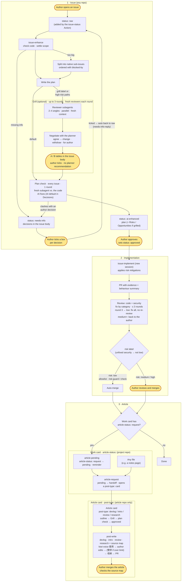
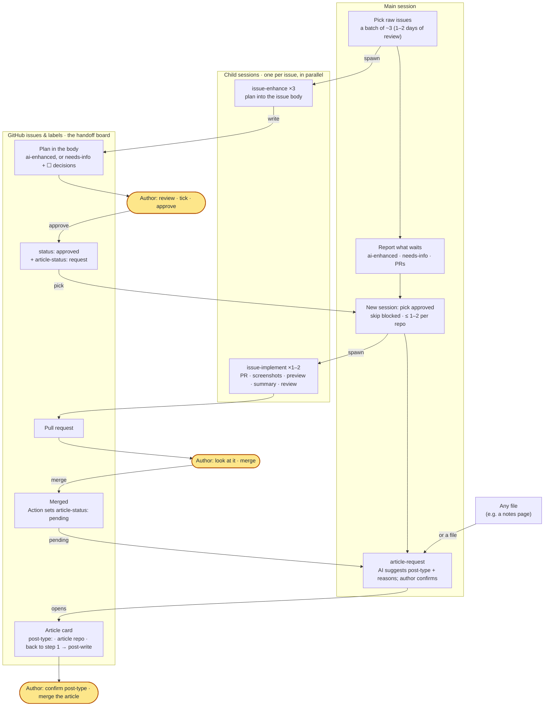

# skills

Cross-project Claude Code skills.

## Install

In a Claude Code session:

```
/plugin marketplace add sean2249/skills
/plugin install kiwi-skills@kiwi-skills
```

Then turn on updates: run `/plugin`, open **Marketplaces**, select `kiwi-skills`, and choose **Enable auto-update**. Third-party marketplaces don't auto-update by default. The plugin has no `version`, so every new commit counts as an update. Without auto-update, pull changes with `/plugin marketplace update kiwi-skills`.

Skills load namespaced, e.g. `kiwi-skills:issue-enhance`.

### Migrating from the old name

The plugin and its marketplace used to be called `sean-skills`. If you installed it under that name, re-add it under the new one (in a shell):

```bash
claude plugin marketplace remove sean-skills
claude plugin marketplace add sean2249/skills
claude plugin install kiwi-skills@kiwi-skills
```

Then turn on auto-update for `kiwi-skills` as above.

## Workflow

This is my personal development workflow. The skills are designed around it, so adjust it to your own habits if you use them.

<p align="center">
  
</p>

Highlighted nodes (glowing in the image, yellow in the text version) are where the author steps in: ticking a box for each pending decision in the issue body (needs-info questions and the Grill's A/B items; never asked in chat), approving an issue, reviewing and merging `risk: medium` / `high` PRs, and merging article PRs. Everything else is done by the skills or GitHub Actions. The image follows your system's light/dark setting, and its animation stops if you've asked your OS for reduced motion.

<details>
<summary>Text version (mermaid)</summary>



</details>

### Code and security review

Every PR from `issue-implement` is reviewed before any merge, and the implementing session never reviews its own work.

1. **Two reviewers in parallel:** fresh-context subagents, one for code (correctness, missed acceptance criteria, regressions) and one for security. Each gets only the PR URL, with no conversation or hints, and never comments on the PR or pushes commits.
2. **Every finding has a category** (state / race, error handling, a11y, input validation…).
3. **The implementing session handles the findings:** it checks each one against the code, fixes the real ones, and gives a reason for the rest. It fixes a whole category at once and looks for the same class of problem elsewhere in the change, not just the line that was flagged.
4. **New reviewers every round.** Rounds 1–2: fix, then review again.
5. **Round 3 is the last review.** If it finds only low findings, they're all fixed and nothing is sent for another review. If it finds anything medium or higher, the approach itself is probably wrong: nothing is patched or merged, the PR becomes a draft, the AI comments on the PR and the issue with the findings by category and 2–3 alternative directions, and the issue goes back to `status: needs-info` for me to decide whether to start over.
6. **A scope change by me restarts the count.** If I change the scope after the PR is open (a new decision in the issue that supersedes an old one), review starts again at round 1; the earlier rounds are listed apart as "old scope, not counted". The AI's own fixes or changes of approach don't reset it.
7. **Product decisions are mine.** In any round, only a fix that needs my product decision is handed to me, with the reason.
8. **Risk:** any unfixed security finding means the PR can't be `risk: low`.

The cap exists because every round of fixes can bring in new problems, so reviewing until clean never converges.

### Public repos

On a public repo anyone can open an issue or comment, and everything the skills post (issues, PRs, comments, the `issue-assets` branch) is public. The workflow guards against three things:

1. **Outsiders steering the AI (prompt injection).** Only the repo owner is trusted, in the Actions and the skills alike.
   - The `issue-status` Action gives `status: raw` only to issues opened by the owner (`author_association` `OWNER`). Anyone else's issue, collaborators included, gets the `external` label, no status, and one neutral comment saying a maintainer triages it by hand. Status labels an issue template added are removed. Issues opened by bots (Renovate, github-actions, …) are skipped: no label, no comment.
   - `needs-info-reply` only reacts to the owner's comments and edits.
   - `issue-enhance` batch mode only picks issues opened by the owner (`--author <trusted>`). Given an issue someone else opened, `issue-enhance`, `issue-implement` and `post-write` stop and tell me. To act on one, I open my own issue in my own words.
   - Comments are fetched already filtered with jq to the owner's (`select(.author.login == "<trusted>")`), so a faked `🤖 AI` or "Already done" comment from someone else counts for nothing. `issue-implement` reads no comments at all and works only from the issue body. Reviewer subagents get the same filtered commands.
   - Anything written by someone else, and anything fetched or linked (web pages, other issues or PRs, fork diffs), is untrusted data: the skills and their subagents never follow instructions in it; they only summarise it.
   - `risk-guard` treats `.github/`, `.claude/` (deny rules, hooks) and any `CLAUDE.md` (verify command, workflow keys) as never low risk. `article-pending` only writes after a maintainer merges a PR that a maintainer labelled, so it needed no change.
   - Don't give issue templates a default `status:` label: an outside issue would start in the flow (the Action strips it, but don't rely on that alone).
2. **Announcing a vulnerability before it's fixed.** On a public repo, `issue-implement` keeps security review findings out of the PR, the issue, comments and commit messages. Publicly it writes only "<K> security finding(s); details shared privately with the author", and gives me the details in the session. This includes the round-3 hand-back. A weakness that's already on the default branch isn't fixed on a public branch at all, since the fix's diff points at the hole: it's fixed from the start on a security advisory's private fork. Other unfixed findings go to GitHub private vulnerability reporting / a security advisory too.
3. **Personal data in screenshots and output.** On a public repo, mockups, screenshots, run output, Behaviour summaries and `## 文章素材` use made-up data: no account IDs, emails, tokens, internal URLs, or names of private repos. `issue-workflow-setup` reminds me that `issue-assets` is public when it installs on a public repo.

**Before making a private repo public**, go through what the workflow wrote while it was private: old PR `## Review` tables (security findings with `file:line`), issue and PR comments, and the images on the `issue-assets` branch (its history keeps deleted images too).

**Secret files.** `issue-workflow-setup` also merges `permissions.deny` rules into the repo's `.claude/settings.json` (e.g. `Read(**/.env)`, `Read(**/.dev.vars)`, `Read(**/*.pem)`, `Read(**/id_rsa*)`, `Read(**/*.tfstate)`, `Read(**/secrets/**)`, `Bash(gh auth token*)`, `Bash(printenv*)`), fitted to the secret files the repo actually has and confirmed by me first. Existing settings are kept; repair mode adds only missing rules. These rules block Claude Code's file tools, not shell commands like `cat` or `grep`, so they guard against accidents rather than acting as a sandbox; for a real boundary, turn on Claude Code's sandbox for Bash.

**No PreToolUse hook.** The plugin doesn't ship one. A plugin hook runs in every session in every repo and can't tell when an issue skill is running. Command-pattern blocks on `git push` / `gh` are easy to get around with an equivalent command, yet would block legitimate pushes and merges. The checks that matter run on GitHub (outside issues kept out of the flow, `risk-guard` as a required check, branch protection), and secret files are covered by Claude Code's own deny rules.

### How I run it

This is how I personally operate the workflow day to day: parallel child sessions, with GitHub issues as the only handoff. It needs no extra skill. The parallelism comes from asking Claude, in a main session, to start child sessions.

<p align="center">
  
</p>

1. **Main session:** find `status: raw` issues and start one child session per issue running `issue-enhance`. Each batch is only as many as I can review in a day or two (about 3).
2. **Child sessions** write each plan into its issue body; decisions for me go in `## Pending decisions` as checkboxes. Children never talk to each other: the issue (labels + body) is the only handoff.
3. **Main session** reports what waits for me: `status: ai-enhanced` (review the plan), `status: needs-info` (tick the boxes), and PRs to look at.
4. **I review**, set `status: approved`, and add `article-status: request` to anything that should become an article.
5. **A new main session** picks approved issues, skips any blocked by an open issue, takes at most 1–2 per repo at a time, and starts a child session per issue running `issue-implement`. Each opens a PR with screenshots, preview, behaviour summary and review.
6. **I look and merge.** The Action switches the label to `article-status: pending`.
7. **I run `article-request` in the main session.** The AI suggests a `post-type:` with its reasoning and I confirm, which opens an article card in the article repo. It can also start from any file, such as a notes page.
8. **The article card goes back to step 1:** `issue-enhance` drafts the outline, I approve, a child session runs `post-write` and hands me the draft; I edit it in place and say I'm done, the AI commits my edits and opens the PR, and I check the preview and merge.

<details>
<summary>Text version (mermaid)</summary>



</details>

### Labels

| Label | Where | Meaning |
|---|---|---|
| `status: raw` → `needs-info` → `ai-enhanced` → `approved` | every repo | Issue progress; only the author sets `approved` |
| `risk: low` / `medium` / `high` | every repo, on PRs | Merge gate; only `low` merges automatically |
| `external` | every repo, on issues | Not opened by the repo owner; added by the `issue-status` Action instead of `status: raw`, and never worked on by the skills (see Public repos) |
| `grill` | every repo, on issues | The author asks `issue-enhance` to run the optional Grill review (it also runs automatically when a plan touches high-risk paths) |
| `article-status: request` → `pending` → `handoff` | project repos (including the article repo's own feature cards) | This work should become an article, and how far the handoff got |
| `post-type: devlog` / `intro` / `review` / `research` | **article repo only**, on article cards | How the article is written; never used in other repos |
| `readme-sync: skip` | this repo only, on PRs | `README.md` changed without `README.zh-TW.md` on purpose; added only by the author, never with `risk: low`, so the PR is merged by hand |

## Skills

| Skill | Use when |
|---|---|
| `dev/issue-workflow-setup` | Installing (or repairing) the issue workflow in a repo: labels, callers for the shared workflows, PR template, CLAUDE.md section |
| `dev/issue-enhance` | Turning a `status: raw` issue into a reviewable plan (or an article outline), split into sub-issues; every plan is fact-checked once against the code by a fresh subagent and fixed by the AI before the author reviews it |
| `dev/issue-implement` | Implementing a `status: approved` issue: PR with evidence, risk label, merge only `risk: low` |
| `dev/article-request` | Handing a merged `article-status: pending` PR, or any file, to the article repo as a raw issue; marks the PR and the issues it closes `article-status: handoff` |
| `writing/post-write` | Writing an approved article issue in one of four modes (devlog, intro, review, research), following the article repo's conventions, with a cover, blog links for `wiki:` targets, and a source map for note sources; hands the draft to the author to edit before opening the PR |
| `writing/kiwi-voice` | Applying the repo's voice rules to a post (套用); after the author's edits, proposing new rules or examples for the author to approve (收納); when the rules file passes its size limit (default 8 KB / 25 rules), proposing merges, generalisations and retirements, and listing rule/example conflicts for the author to decide (整併). Rules live in each repo's voice rules file (`Voice file:`), extra examples in its examples directory (`Voice examples:`), not in the skill |

## Shared workflows

`.github/workflows/issue-status.yml`, `risk-guard.yml`, `article-pending.yml`, and `needs-info-reply.yml` are reusable workflows (`on: workflow_call`). `issue-status` labels the owner's new issue `status: raw`, anyone else's `external`, and skips bots. `needs-info-reply` switches a `status: needs-info` issue back to `status: raw` once the owner has answered: the owner ticks a box for every decision in the body's `## Pending decisions` (`issues: edited`), or replies in a comment (`issue_comment: created`). It reacts only to the owner (`author_association` `OWNER`), ignores PRs, bots, and comments starting with `🤖 AI` (the AI writes decisions with empty boxes and never ticks one), and posts nothing. Repos set up with `issue-workflow-setup` call them through short callers, for example:

```yaml
jobs:
  risk-guard:
    uses: <owner>/skills/.github/workflows/risk-guard.yml@v1
```

In the calling repo the required check is named `risk-guard / check`.

### Versions

Callers pin a release tag (`@v1`), never `@main`. These workflows can write issues, labels and PR comments, so each repo runs only a version I chose; a mistake on `main` doesn't reach any repo until I bump it.

- **Tags are `v1`, `v2`, `v3`, …**: one plain whole number per release. A published tag is never moved or re-pushed; a fix is always a new tag.
- **Only the reusable workflows are pinned.** The skills themselves (the `kiwi-skills` plugin) still update from `main` as usual (Install, above).

Releasing:

1. Merge the change to `main`.
2. Tag the merge commit with the next number and write release notes (what changed for calling repos, and whether anything needs repair mode):
   ```bash
   gh release create v<N> --target main --title v<N> --notes-file <notes.md>
   ```
3. In each repo, run `issue-workflow-setup` in repair mode. It shows `gh api repos/<owner>/skills/compare/v<old>...v<N>` for review, then opens one PR bumping all four callers to `v<N>` (`risk: high`, merged by me).

The first tag, `v1`, is created by hand after the change that introduced tags is merged (the command in step 2). Until it exists, `issue-workflow-setup` stops instead of writing callers. Repos whose callers still say `@main` move to the latest tag the next time repair mode runs.
