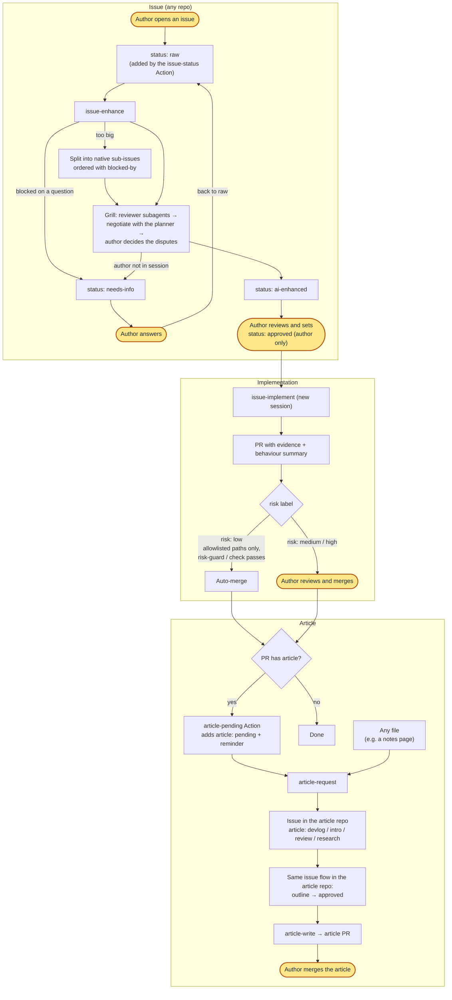

# skills

Cross-project Claude Code skills.

## Install

In a Claude Code session:

```
/plugin marketplace add sean2249/skills
/plugin install kiwi-skills@kiwi-skills
```

Then turn on updates: run `/plugin`, open **Marketplaces**, select `kiwi-skills`, and choose **Enable auto-update**. Third-party marketplaces don't auto-update by default. The plugin has no `version`, so every new commit counts as an update. Without auto-update, pull changes with `/plugin marketplace update kiwi-skills`.

Skills load namespaced, e.g. `kiwi-skills:issue-enhance`.

### Migrating from the old name

The plugin and its marketplace used to be called `sean-skills`. If you installed it under that name, re-add it under the new one (in a shell):

```bash
claude plugin marketplace remove sean-skills
claude plugin marketplace add sean2249/skills
claude plugin install kiwi-skills@kiwi-skills
```

Then turn on auto-update for `kiwi-skills` as above.

## Workflow

This is my personal development workflow. The skills are designed around it, so adjust it to your own habits if you use them.



Yellow rounded nodes are the points where the author steps in: approving an issue, answering a needs-info question, reviewing and merging `risk: medium` / `high` PRs, and merging article PRs. Everything else is done by the skills or GitHub Actions.

## Skills

| Skill | Use when |
|---|---|
| `dev/issue-workflow-setup` | Installing (or repairing) the issue workflow in a repo: labels, callers for the shared workflows, PR template, CLAUDE.md section |
| `dev/issue-enhance` | Turning a `status: raw` issue into a reviewable plan (or an article outline), split into sub-issues |
| `dev/issue-implement` | Implementing a `status: approved` issue: PR with evidence, risk label, merge only `risk: low` |
| `dev/article-request` | Handing a merged `article` PR, or any file, to the article repo as a raw issue |
| `writing/article-write` | Writing an approved article issue in one of four modes (devlog, intro, review, research), following the article repo's conventions, with a source map for note sources |

## Shared workflows

`.github/workflows/issue-status.yml`, `risk-guard.yml`, and `article-pending.yml` are reusable workflows (`on: workflow_call`). Repos set up with `issue-workflow-setup` call them through short callers, for example:

```yaml
jobs:
  risk-guard:
    uses: <owner>/skills/.github/workflows/risk-guard.yml@main
```

In the calling repo the required check is named `risk-guard / check`.

Callers pin `@main`: one change here reaches every repo on its next run. The trade-off is that these workflows can write issues, labels and PR comments, so a mistake on `main` hits every repo at once. To lock a repo, point its callers at a tag (`@v1`) or a full commit SHA (`@<sha>`). To upgrade later, review `gh api repos/<owner>/skills/compare/<old>...<new>` and bump the ref in all callers in one PR.
