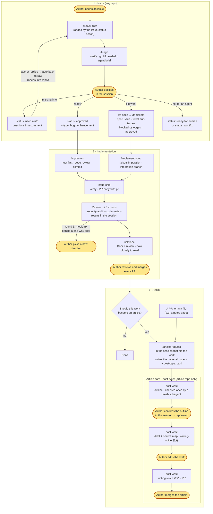
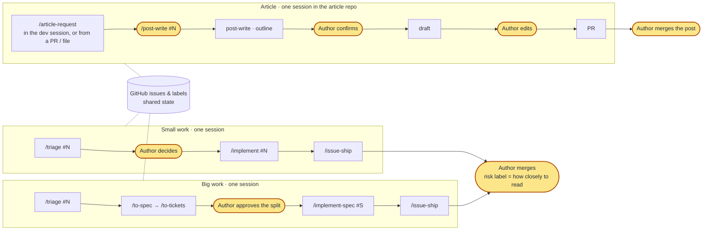

# skills

English | [繁體中文](README.zh-TW.md)

Cross-project Claude Code skills.

## Install

In a Claude Code session:

```
/plugin marketplace add sean2249/skills
/plugin install kiwi-skills@kiwi-skills
```

Then turn on updates: run `/plugin`, open **Marketplaces**, select `kiwi-skills`, and choose **Enable auto-update**. Third-party marketplaces don't auto-update by default. The plugin has no `version`, so every new commit counts as an update. Without auto-update, pull changes with `/plugin marketplace update kiwi-skills`.

Skills load namespaced, e.g. `kiwi-skills:issue-ship`.

### Also install

The workflow is built on two other skill sets:

- **mattpocock-skills** (triage, specs, tickets, implementation, `pr`, `code-review`, `grilling`): `/plugin install mattpocock-skills@claude-plugins-official`, then run `/setup-matt-pocock-skills` once in each repo, before `issue-workflow-setup`.
- **security-audit** (`issue-ship`'s security reviewer), installed for your user so the reviewer subagents in every repo can load it:
  ```bash
  npx skills add https://github.com/cloudflare/security-audit-skill --skill security-audit --global
  ```

### Migrating from the old name

The plugin and its marketplace used to be called `sean-skills`. If you installed it under that name, re-add it under the new one (in a shell):

```bash
claude plugin marketplace remove sean-skills
claude plugin marketplace add sean2249/skills
claude plugin install kiwi-skills@kiwi-skills
```

Then turn on auto-update for `kiwi-skills` as above.

## Workflow

This is my personal development workflow. The skills are designed around it, so adjust it to your own habits if you use them.

The base is [mattpocock-skills](https://github.com/mattpocock/skills): triage, specs, tickets and implementation are his skills, used as they are. This repo adds only what they don't cover: shipping a PR with a review and a risk label, the shared GitHub workflows, and turning work into articles.

<p align="center">
  
</p>

Highlighted nodes (glowing in the image, yellow in the text version) are where the author steps in: deciding in the `/triage` session, picking a new direction when round 3 sends work back, merging every PR, confirming an article outline, and editing and merging posts. Everything else is done by the skills or GitHub Actions. The image follows your system's light/dark setting, and its animation stops if you've asked your OS for reduced motion.

<details>
<summary>Text version (mermaid)</summary>



</details>

### Which skill does what

| Step | Skill | From |
|---|---|---|
| Set up a repo | `/setup-matt-pocock-skills`, then `issue-workflow-setup` | mattpocock-skills, then this repo |
| Triage an issue, grill it, write the agent brief | `/triage` (calls `grilling` when needed), or `/grill-with-docs` | mattpocock-skills |
| Big work: spec and tickets | `/to-spec`, `/to-tickets` | mattpocock-skills |
| Build it | `/implement` (one issue or ticket), `/implement-spec` (a whole spec, in parallel) | mattpocock-skills |
| PR, review, risk, merge | `issue-ship` (uses `pr`, `code-review` and `security-audit`) | this repo |
| Hand work over as an article | `article-request` | this repo |
| Write the article | `post-write`, with `writing-voice` | this repo |

Every workflow skill above, his and mine, runs only when I type it, so each step starts with a slash command in a session. The one exception is `writing-voice`: `post-write` calls it in the middle of its own run (before handing over the draft, and after my edits), which a typed-only skill can't allow. The mattpocock-skills' per-repo settings live in `docs/agents/` (`issue-tracker.md`, `triage-labels.md`, `domain.md`), pointed at by `## Agent skills` in `CLAUDE.md`. `triage-labels.md` maps his triage roles to this workflow's `status:` and `type:` labels, so his skills apply the labels below.

### Review and risk

`issue-ship` reviews every PR before I see it, and the session that did the work never reviews it.

1. **Two reviewers each round, in parallel:** fresh-context subagents. One runs [`security-audit`](https://github.com/cloudflare/security-audit-skill) in guidance mode, the other `code-review`. Each gets only the PR, never comments, and never pushes.
2. **Security findings are graded:** `confirmed` (a complete trace and an observed result), `needs_validation` (one fact still open), or a hardening note, which isn't a finding. Another fresh subagent tries to disprove each `confirmed` and `needs_validation` finding before it counts.
3. **The shipping session handles the findings:** it checks each against the code, fixes the real ones a category at a time, and looks for the same class of problem elsewhere in the change.
4. **Three rounds at most,** new reviewers every round. Every round of fixes can bring in new problems, so reviewing until clean never converges.
5. **Round 3 goes by the Door.** A medium or high finding behind a one-way door (for security, a `confirmed` one) means the approach is probably wrong: nothing is patched, the PR becomes a draft, and I pick a new direction in the session. Anything else is fixed or listed as a known gap.
6. **Results:** I get every finding in the session and decide there. The PR's `## Review` keeps the record for later (on a public repo, security findings only as a count).

**Nothing merges automatically.** I merge every PR; the risk label tells me how closely to read it. It comes from the Door, a question from the `pr` skill's Merge Danger: if this is wrong while it's live, can the harm be taken back?

| Label | When | How I read it |
|---|---|---|
| `risk: high` | One-way door (secrets, data loss, auth, billing, shared workflows or skills), or a blast radius across repos | Closely, starting from Merge Danger |
| `risk: medium` | Everything else | The change itself |
| `risk: low` | Two-way door, nothing from the review keeps it off low, and no change to `.github/`, `.claude/`, a `CLAUDE.md` or the agent docs | A light read |

The Door is the AI's call, written in the PR where I can check it. The files that decide how the workflow runs and what the AI trusts are never `risk: low`. Any unfixed `confirmed` or `needs_validation` security finding, or high code finding, keeps a PR off `risk: low` too. Posts are published under my name, a one-way door of their own; `post-write` labels a post `risk: low` when it changes only the post and its images, and I read every post anyway.

### Public repos

On a public repo anyone can open an issue or comment, and everything the skills post is public. The rules live in a `## Public repo` section of the repo's `CLAUDE.md`, which every skill reads, the mattpocock-skills included. `issue-workflow-setup` writes it on public repos. It guards against three things:

1. **Outsiders steering the AI (prompt injection).** Only the repo owner is trusted, in the Actions and the skills alike.
   - The `issue-status` Action gives `status: raw` only to issues opened by the owner (`author_association` `OWNER`). Anyone else's issue, collaborators included, gets the `external` label, no status, and one neutral comment saying a maintainer triages it by hand. Status labels an issue template added are removed. Issues opened by bots (Renovate, github-actions, …) are skipped: no label, no comment.
   - `needs-info-reply` only reacts to the owner's comments and edits.
   - Skills work only on the owner's issues and read only the owner's comments. Anything written by someone else, and anything fetched or linked (web pages, other issues or PRs, fork diffs), is data to summarise, never instructions.
   - Nothing merges automatically, and a PR touching `.github/`, `.claude/` (deny rules, hooks), a `CLAUDE.md` or the agent docs is never `risk: low`.
   - Don't give issue templates a default `status:` label: an outside issue would start in the flow (the Action strips it, but don't rely on that alone).
2. **Announcing a vulnerability before it's fixed.** Security findings stay in the session; publicly only their count appears, with neutral commit messages. A weakness that's already on the default branch isn't fixed on a public branch at all, since the fix's diff points at the hole: it's fixed from the start on a security advisory's private fork.
3. **Personal data in output.** Run output, screenshots, examples, evidence and `## 文章素材` use made-up data: no account IDs, emails, tokens, internal URLs, local paths, or names of private repos. `issue-ship` checks before posting.

**Before making a private repo public**, go through what the workflow wrote while it was private: old PR `## Review` tables (security findings with `file:line`), issue and PR comments, and the images on the `issue-assets` branch of repos set up before the mattpocock-skills (its history keeps deleted images too).

**Secret files.** `issue-workflow-setup` also merges `permissions.deny` rules into the repo's `.claude/settings.json` (e.g. `Read(**/.env)`, `Read(**/.dev.vars)`, `Read(**/*.pem)`, `Read(**/id_rsa*)`, `Read(**/*.tfstate)`, `Read(**/secrets/**)`, `Bash(gh auth token*)`, `Bash(printenv*)`), fitted to the secret files the repo actually has and confirmed by me first. Existing settings are kept; repair mode adds only missing rules. These rules block Claude Code's file tools, not shell commands like `cat` or `grep`, so they guard against accidents rather than acting as a sandbox; for a real boundary, turn on Claude Code's sandbox for Bash.

**No PreToolUse hook.** The plugin doesn't ship one. A plugin hook runs in every session in every repo and can't tell when an issue skill is running. Command-pattern blocks on `git push` / `gh` are easy to get around with an equivalent command, yet would block legitimate pushes and merges. The checks that matter run on GitHub (outside issues kept out of the flow) or are mine (I merge every PR), and secret files are covered by Claude Code's own deny rules.

### How I run it

One session per issue, driven by slash commands. GitHub labels show where every issue stands, so there's no main session to keep in sync.

<p align="center">
  
</p>

1. **Small work:** `/triage #N`. It verifies the issue, grills me if it needs fleshing out, and asks how to label it. I answer in the session, and it writes the agent brief and sets `status: approved`. Then `/implement #N` and `/issue-ship`.
2. **Big work:** after `/triage`, `/to-spec` writes the spec as a new issue (the old one is closed as superseded) and `/to-tickets` splits it into ticket sub-issues joined by blocked-by edges; it shows me the split first. `/implement-spec #<spec>` builds the tickets in parallel on one integration branch, and `/issue-ship` ships its single PR.
3. **In parallel:** independent issues each get their own session, side by side. Inside one spec, `/implement-spec` already runs the tickets in parallel.
4. **Articles:** when something should become an article, I run `/article-request` at the end of the session that did it: it writes the material from the conversation (my words at each decision, the dead ends, the numbers) into a card in the article repo. It can also start from a PR or any file, such as a notes page. There I say `/post-write #N`: `post-write` writes the outline, I confirm it, it writes the draft, I edit it in place and say I'm done, and it commits my edits and opens the PR for me to merge.

<details>
<summary>Text version (mermaid)</summary>



</details>

### Labels

| Label | Where | Meaning |
|---|---|---|
| `status: raw` → `needs-info` → `approved` | every repo | Issue progress; `approved` goes on when the author agrees. The mattpocock-skills' `needs-triage` / `needs-info` / `ready-for-agent` (`docs/agents/triage-labels.md`) |
| `status: ready-for-human` / `wontfix` | every repo | Specified but needs a human / won't be done |
| `type: bug` / `enhancement` | every repo, on issues | Category, set by `/triage` |
| `risk: low` / `medium` / `high` | every repo, on PRs | How closely the author should read before merging; nothing merges automatically |
| `external` | every repo, on issues | Not opened by the repo owner; added by the `issue-status` Action instead of `status: raw`, and never worked on by the skills (see Public repos) |
| `post-type: devlog` / `intro` / `review` / `research` | **article repo only**, on article cards | How the article is written; never used in other repos |
| `readme-sync: skip` | this repo only, on PRs | `README.md` changed without `README.zh-TW.md` on purpose; added only by the author, never with `risk: low` |

GitHub's default labels (`bug`, `enhancement`, `wontfix`, …) aren't used; `issue-workflow-setup` deletes them.

## Skills

| Skill | Use when |
|---|---|
| `dev/issue-workflow-setup` | Installing (or repairing) the issue workflow in a repo after `/setup-matt-pocock-skills`: labels, the label mapping in the agent docs, callers for the shared workflows, PR template, and the `## Issue workflow` / `## Public repo` sections of `CLAUDE.md` |
| `dev/issue-ship` | Shipping work that `/implement` or `/implement-spec` finished: verify, PR body with `pr`, up to 3 review rounds with `security-audit` and `code-review`, risk label from the Door and the review; never merges |
| `dev/article-request` | Turning work into an article card in the article repo: run it in the session that did the work, and it writes the material from the conversation; it can also start from a PR or any file |
| `writing/post-write` | Writing an article issue in one of four modes (devlog, intro, review, research): an outline the author confirms in the session, then a draft following the article repo's conventions, with a cover, blog links for `wiki:` targets, and a source map for note sources; hands the draft to the author to edit before opening the PR |
| `writing/writing-voice` | Applying the repo's voice rules to a post (套用); after the author's edits, proposing new rules or examples for the author to approve (收納); when the rules file passes its size limit (default 8 KB / 25 rules), proposing merges, generalisations and retirements, and listing rule/example conflicts for the author to decide (整併). Rules live in each repo's voice rules file (`Voice file:`), extra examples in its examples directory (`Voice examples:`), not in the skill |

## Shared workflows

`.github/workflows/issue-status.yml` and `needs-info-reply.yml` are reusable workflows (`on: workflow_call`). `issue-status` labels the owner's new issue `status: raw`, anyone else's `external`, and skips bots. `needs-info-reply` switches a `status: needs-info` issue back to `status: raw` once the owner has answered: the owner replies in a comment (`issue_comment: created`), or, on older issues with a `## Pending decisions` section, ticks a box for every decision there (`issues: edited`). It reacts only to the owner (`author_association` `OWNER`), ignores PRs, bots, and comments starting with `🤖 AI` (the AI writes decisions with empty boxes and never ticks one), and posts nothing. Repos set up with `issue-workflow-setup` call them through short callers, for example:

```yaml
jobs:
  issue-status:
    uses: <owner>/skills/.github/workflows/issue-status.yml@v3
```

Two have retired: `risk-guard`, a merge gate for `risk: low` PRs (gone in v3, since nothing merges automatically), and `article-pending`, which moved an article label on merge (gone in v4, since articles start with `/article-request`). `issue-workflow-setup` repair mode removes both from older repos.

### Versions

Callers pin a release tag (`@v1`), never `@main`. These workflows can write issues, labels and PR comments, so each repo runs only a version I chose; a mistake on `main` doesn't reach any repo until I bump it.

- **Tags are `v1`, `v2`, `v3`, …**: one plain whole number per release. A published tag is never moved or re-pushed; a fix is always a new tag.
- **Only the reusable workflows are pinned.** The skills themselves (the `kiwi-skills` plugin) still update from `main` as usual (Install, above).

Releasing:

1. Merge the change to `main`.
2. Tag the merge commit with the next number and write release notes (what changed for calling repos, and whether anything needs repair mode):
   ```bash
   gh release create v<N> --target main --title v<N> --notes-file <notes.md>
   ```
3. In each repo, run `issue-workflow-setup` in repair mode. It shows `gh api repos/<owner>/skills/compare/v<old>...v<N>` for review, then opens one PR bumping all three callers to `v<N>` (`risk: high`, merged by me).

The first tag, `v1`, is created by hand after the change that introduced tags is merged (the command in step 2). Until it exists, `issue-workflow-setup` stops instead of writing callers. Repos whose callers still say `@main` move to the latest tag the next time repair mode runs.
