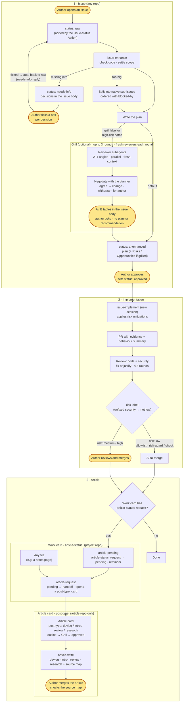

# skills

Cross-project Claude Code skills.

## Install

In a Claude Code session:

```
/plugin marketplace add sean2249/skills
/plugin install kiwi-skills@kiwi-skills
```

Then turn on updates: run `/plugin`, open **Marketplaces**, select `kiwi-skills`, and choose **Enable auto-update**. Third-party marketplaces don't auto-update by default. The plugin has no `version`, so every new commit counts as an update. Without auto-update, pull changes with `/plugin marketplace update kiwi-skills`.

Skills load namespaced, e.g. `kiwi-skills:issue-enhance`.

### Migrating from the old name

The plugin and its marketplace used to be called `sean-skills`. If you installed it under that name, re-add it under the new one (in a shell):

```bash
claude plugin marketplace remove sean-skills
claude plugin marketplace add sean2249/skills
claude plugin install kiwi-skills@kiwi-skills
```

Then turn on auto-update for `kiwi-skills` as above.

## Workflow

This is my personal development workflow. The skills are designed around it, so adjust it to your own habits if you use them.

<p align="center">
  
</p>

Highlighted nodes (glowing in the image, yellow in the text version) are where the author steps in: ticking a box for each pending decision in the issue body (needs-info questions and the Grill's A/B items; never asked in chat), approving an issue, reviewing and merging `risk: medium` / `high` PRs, and merging article PRs. Everything else is done by the skills or GitHub Actions. The image follows your system's light/dark setting, and its animation stops if you've asked your OS for reduced motion.

<details>
<summary>Text version (mermaid)</summary>



</details>

### Labels

| Label | Where | Meaning |
|---|---|---|
| `status: raw` → `needs-info` → `ai-enhanced` → `approved` | every repo | Issue progress; only the author sets `approved` |
| `risk: low` / `medium` / `high` | every repo, on PRs | Merge gate; only `low` merges automatically |
| `grill` | every repo, on issues | The author asks `issue-enhance` to run the optional Grill review (it also runs automatically when a plan touches high-risk paths) |
| `article-status: request` → `pending` → `handoff` | project repos (including the article repo's own feature cards) | This work should become an article, and how far the handoff got |
| `post-type: devlog` / `intro` / `review` / `research` | **article repo only**, on article cards | How the article is written; never used in other repos |

## Skills

| Skill | Use when |
|---|---|
| `dev/issue-workflow-setup` | Installing (or repairing) the issue workflow in a repo: labels, callers for the shared workflows, PR template, CLAUDE.md section |
| `dev/issue-enhance` | Turning a `status: raw` issue into a reviewable plan (or an article outline), split into sub-issues |
| `dev/issue-implement` | Implementing a `status: approved` issue: PR with evidence, risk label, merge only `risk: low` |
| `dev/article-request` | Handing a merged `article-status: pending` PR, or any file, to the article repo as a raw issue; marks the PR `article-status: handoff` |
| `writing/article-write` | Writing an approved article issue in one of four modes (devlog, intro, review, research), following the article repo's conventions, with a source map for note sources |

## Shared workflows

`.github/workflows/issue-status.yml`, `risk-guard.yml`, `article-pending.yml`, and `needs-info-reply.yml` are reusable workflows (`on: workflow_call`). `needs-info-reply` switches a `status: needs-info` issue back to `status: raw` once the author has answered: either the issue's author or the repo owner ticks a box for every decision in the body's `## Pending decisions` (`issues: edited`), or replies in a comment (`issue_comment: created`). It ignores PRs, bots, other users, and comments starting with `🤖 AI` (the AI writes decisions with empty boxes and never ticks one), and posts nothing. Repos set up with `issue-workflow-setup` call them through short callers, for example:

```yaml
jobs:
  risk-guard:
    uses: <owner>/skills/.github/workflows/risk-guard.yml@main
```

In the calling repo the required check is named `risk-guard / check`.

Callers pin `@main`: one change here reaches every repo on its next run. The trade-off is that these workflows can write issues, labels and PR comments, so a mistake on `main` hits every repo at once. To lock a repo, point its callers at a tag (`@v1`) or a full commit SHA (`@<sha>`). To upgrade later, review `gh api repos/<owner>/skills/compare/<old>...<new>` and bump the ref in all callers in one PR.
