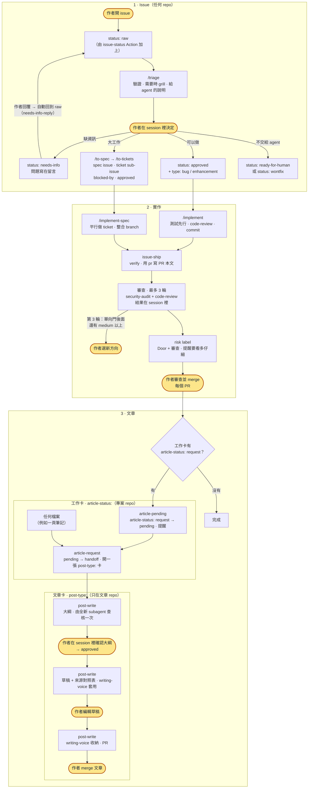
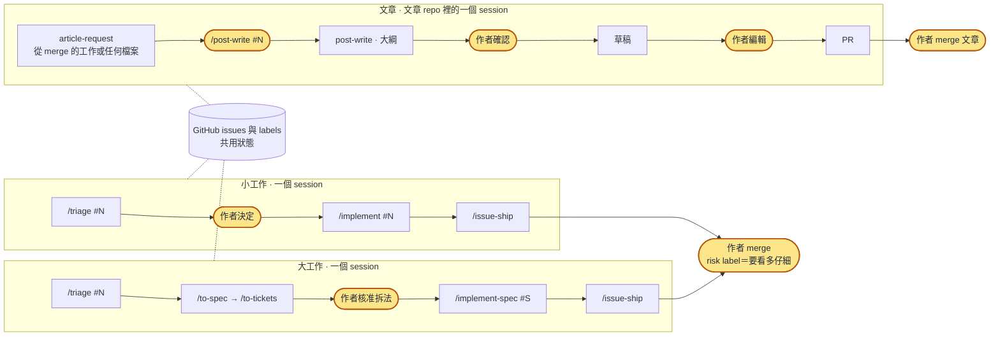

# skills

[English](README.md) | 繁體中文

跨專案共用的 Claude Code skills。

## 安裝

在 Claude Code session 裡：

```
/plugin marketplace add sean2249/skills
/plugin install kiwi-skills@kiwi-skills
```

接著打開自動更新：執行 `/plugin`，進入 **Marketplaces**，選 `kiwi-skills`，再選 **Enable auto-update**。第三方 marketplace 預設不會自動更新。這個 plugin 沒有 `version`，所以每個新 commit 都算一次更新。沒開自動更新的話，用 `/plugin marketplace update kiwi-skills` 拉取更新。

Skills 載入時會帶命名空間，例如 `kiwi-skills:issue-ship`。

### 另外要安裝

這個工作流程建立在另外兩套 skill 上：

- **mattpocock-skills**（分類、spec、ticket、實作、`pr`、`code-review`、`grilling`）：`/plugin install mattpocock-skills@claude-plugins-official`，然後在每個 repo 先跑一次 `/setup-matt-pocock-skills`，再跑 `issue-workflow-setup`。
- **security-audit**（`issue-ship` 的資安 reviewer），裝在使用者層級，讓每個 repo 的 reviewer subagent 都載入得到：
  ```bash
  npx skills add https://github.com/cloudflare/security-audit-skill --skill security-audit --global
  ```

### 從舊名稱遷移

這個 plugin 和它的 marketplace 以前叫 `sean-skills`。如果你是用舊名稱安裝的，請用新名稱重新加入（在 shell 裡）：

```bash
claude plugin marketplace remove sean-skills
claude plugin marketplace add sean2249/skills
claude plugin install kiwi-skills@kiwi-skills
```

然後照上面的方式替 `kiwi-skills` 打開自動更新。

## 工作流程

這是我個人的開發工作流程。這些 skills 是圍繞它設計的，如果你要用，請依自己的習慣調整。

底層是 [mattpocock-skills](https://github.com/mattpocock/skills)：分類、spec、ticket 和實作都直接用他的 skills，不做修改。這個 repo 只補上他沒有的部分：附審查與 risk label 的 PR 出貨、共用的 GitHub workflow，以及把工作寫成文章。

<p align="center">
  
</p>

標亮的節點（圖中發光、文字版中為黃色）是作者介入的地方：在 `/triage` 的 session 裡做決定、第 3 輪交回時選新方向、merge 每個 PR、確認文章大綱，以及編輯並 merge 文章。其餘都由 skills 或 GitHub Actions 完成。圖片會跟著系統的淺色／深色設定切換；如果你在作業系統要求減少動態效果，動畫會停止。

<details>
<summary>文字版（mermaid）</summary>



</details>

### 哪一步用哪個 skill

| 步驟 | Skill | 來源 |
|---|---|---|
| 設定 repo | `/setup-matt-pocock-skills`，接著 `issue-workflow-setup` | mattpocock-skills，接著這個 repo |
| 分類 issue、grill、寫給 agent 的說明 | `/triage`（需要時會叫 `grilling`），或 `/grill-with-docs` | mattpocock-skills |
| 大工作：spec 和 ticket | `/to-spec`、`/to-tickets` | mattpocock-skills |
| 實作 | `/implement`（一張 issue 或 ticket）、`/implement-spec`（整份 spec，平行做） | mattpocock-skills |
| PR、審查、risk、merge | `issue-ship`（會用到 `pr`、`code-review` 和 `security-audit`） | 這個 repo |
| 把工作交接成文章 | `article-request` | 這個 repo |
| 寫文章 | `post-write`，搭配 `writing-voice` | 這個 repo |

上面每個流程類 skill，不論是他的還是我的，都只在我自己輸入時才會執行，所以每一步都是在 session 裡下一個 slash 指令開始。唯一的例外是 `writing-voice`：`post-write` 執行到一半會叫它（交出草稿前、我改完稿後各一次），只能手動觸發的 skill 做不到這點。mattpocock-skills 在各 repo 的設定放在 `docs/agents/`（`issue-tracker.md`、`triage-labels.md`、`domain.md`），由 `CLAUDE.md` 的 `## Agent skills` 指過去。`triage-labels.md` 把他的分類角色對應到這個工作流程的 `status:` 和 `type:` label，所以他的 skills 貼的就是下面的 labels。

### 審查與 risk

`issue-ship` 在交給我之前都會審查每個 PR，而且做這份工作的 session 從不審查自己的成果。

1. **每一輪兩位 reviewer 平行審查：** 都是全新 context 的 subagent。一位用 guidance 模式跑 [`security-audit`](https://github.com/cloudflare/security-audit-skill)，另一位跑 `code-review`。每位只拿到 PR，從不留言，也不推 commit。
2. **資安問題分級：** `confirmed`（有完整的觸發路徑和看得到的結果）、`needs_validation`（還差一個事實沒釐清），或補強建議（不算問題）。每個 `confirmed` 和 `needs_validation` 的問題都會先交給另一個全新 subagent 嘗試推翻，推不翻才算數。
3. **由出貨的 session 處理問題：** 逐一對照程式碼檢查，同一類別一次修完，並在這次改動的其他地方找同類問題。
4. **最多 3 輪，** 每一輪都換新的 reviewer。每一輪修正都可能帶進新問題，一直審到乾淨為止永遠不會收斂。
5. **第 3 輪看 Door。** 還有單向門後面的 medium 以上問題（資安要是 `confirmed` 的），代表做法本身可能有誤：什麼都不修補，PR 轉成 draft，由我在 session 裡選新方向。其他問題就修掉，或列為已知缺口。
6. **結果：** 每個問題都在 session 裡告訴我，由我在那裡決定。PR 的 `## Review` 留下紀錄供之後使用（公開 repo 的資安問題只寫數量）。

**沒有任何東西會自動 merge。** 每個 PR 都由我 merge，risk label 提醒我要看多仔細。它由 Door 決定，這個問題來自 `pr` skill 的 Merge Danger：如果上線期間這個改動出錯，傷害收得回來嗎？

| Label | 什麼時候 | 我怎麼看 |
|---|---|---|
| `risk: high` | 單向門（機密、資料遺失、auth、計費、共用 workflow 或 skills），或影響範圍跨 repo | 仔細看，從 Merge Danger 開始 |
| `risk: medium` | 其他 | 看改動本身 |
| `risk: low` | 雙向門，審查沒有留下讓它不能是 low 的問題，而且沒改到 `.github/`、`.claude/`、`CLAUDE.md` 或 agent 設定檔 | 輕輕看過 |

Door 是 AI 的判斷，寫在 PR 裡讓我核對。決定工作流程怎麼跑、AI 信任什麼的那些檔案，一律不能是 `risk: low`。只要有未修的 `confirmed` 或 `needs_validation` 資安問題，或未修的 high 程式碼問題，PR 也不能是 `risk: low`。文章用我的名字發佈，本身就是單向門；只改到文章本身和它的圖片時，`post-write` 標成 `risk: low`，而我每篇文章都會讀。

### 公開 repo

在公開 repo 上，任何人都能開 issue 或留言，而 skills 貼出的所有東西都是公開的。規則寫在 repo `CLAUDE.md` 的 `## Public repo` 段落，每個 skill 都會讀它，mattpocock-skills 也一樣。`issue-workflow-setup` 會在公開 repo 寫入這一段。它防範三件事：

1. **外人操控 AI（prompt injection）。** 不論 Actions 或 skills，只信任 repo owner。
   - `issue-status` Action 只替 owner 開的 issue（`author_association` `OWNER`）加 `status: raw`。其他人開的 issue，包括 collaborator，會拿到 `external` label、沒有狀態，以及一則中性留言說明會由維護者手動分類。issue 範本加上的狀態 label 會被移除。bot（Renovate、github-actions…）開的 issue 會被略過：不加 label、不留言。
   - `needs-info-reply` 只對 owner 的留言和編輯有反應。
   - Skills 只處理 owner 的 issue，也只讀 owner 的留言。別人寫的任何東西，以及抓取或連結到的任何內容（網頁、其他 issue 或 PR、fork 的 diff），都只做摘要，從不當成指示。
   - 沒有任何東西會自動 merge，而且改到 `.github/`、`.claude/`（deny 規則、hooks）、`CLAUDE.md` 或 agent 設定檔的 PR 一律不能是 `risk: low`。`article-pending` 只在維護者 merge 了一個由維護者加上 label 的 PR 之後才寫入。
   - 不要替 issue 範本設預設的 `status:` label：外部 issue 會因此直接進入流程（Action 會拿掉它，但不要只靠這一層）。
2. **在修好之前就公開了漏洞。** 資安問題留在 session 裡；公開的地方只出現數量，commit 訊息也保持中性。已經在預設 branch 上的弱點完全不在公開 branch 上修，因為修正的 diff 會指出漏洞在哪裡：它從一開始就在 security advisory 的私有 fork 上修。
3. **輸出裡的個人資料。** 執行輸出、截圖、範例、證據和 `## 文章素材` 都用假資料：不放帳號 ID、email、token、內部網址、本機路徑或私人 repo 的名稱。`issue-ship` 在貼出前會檢查。

**把私人 repo 改成公開之前**，先檢查工作流程在它還是私人時寫下的東西：舊 PR 的 `## Review` 表（帶 `file:line` 的資安問題）、issue 和 PR 的留言，以及改用 mattpocock-skills 之前設定的 repo 裡 `issue-assets` branch 上的圖片（它的歷史也保留了刪掉的圖）。

**機密檔案。** `issue-workflow-setup` 也會把 `permissions.deny` 規則合併進 repo 的 `.claude/settings.json`（例如 `Read(**/.env)`、`Read(**/.dev.vars)`、`Read(**/*.pem)`、`Read(**/id_rsa*)`、`Read(**/*.tfstate)`、`Read(**/secrets/**)`、`Bash(gh auth token*)`、`Bash(printenv*)`），依 repo 實際有的機密檔案調整，並先經我確認。既有設定會保留；repair 模式只補上缺少的規則。這些規則擋的是 Claude Code 的檔案工具，不是 `cat` 或 `grep` 這類 shell 指令，所以它們防的是意外，而不是沙盒；要有真正的邊界，請替 Bash 打開 Claude Code 的 sandbox。

**沒有 PreToolUse hook。** 這個 plugin 不附帶 hook。plugin 的 hook 會在每個 repo 的每個 session 裡執行，也分辨不出什麼時候在跑 issue skill。針對 `git push` / `gh` 的指令樣式封鎖，很容易用等效指令繞過，卻會擋到正常的 push 和 merge。真正重要的檢查在 GitHub 上執行（外部 issue 不進流程），或由我來做（每個 PR 都由我 merge），機密檔案則由 Claude Code 自己的 deny 規則處理。

### 我怎麼運作它

一張 issue 一個 session，用 slash 指令推進。每張 issue 走到哪裡都看 GitHub labels，所以沒有需要同步的主 session。

<p align="center">
  
</p>

1. **小工作：** `/triage #N`。它驗證 issue，需要補充時會 grill 我，並問我怎麼標。我在 session 裡回答，它就寫好給 agent 的說明並設成 `status: approved`。接著 `/implement #N` 和 `/issue-ship`。
2. **大工作：** `/triage` 之後，`/to-spec` 把 spec 寫成一張新 issue（舊的那張標成被取代後關閉），`/to-tickets` 把它拆成用 blocked-by 串起來的 ticket sub-issue，發出去之前會先給我看拆法。`/implement-spec #<spec>` 在一條整合 branch 上平行做完所有 ticket，`/issue-ship` 出貨它唯一的那個 PR。
3. **平行：** 互不相關的 issue 各開一個 session，同時進行。同一份 spec 裡的 ticket，`/implement-spec` 本來就會平行做。
4. **文章：** 要寫成文章的工作我會加上 `article-status: request`。merge 之後，`article-request` 在文章 repo 開一張卡（也可以從任何檔案開始，例如一頁筆記）。我在那裡下 `/post-write #N`：`post-write` 寫大綱、我確認、它寫草稿、我直接在檔案上編輯並說改好了，它幫我 commit 編輯並開 PR，由我 merge。

<details>
<summary>文字版（mermaid）</summary>



</details>

### Labels

| Label | 用在哪裡 | 意思 |
|---|---|---|
| `status: raw` → `needs-info` → `approved` | 每個 repo | Issue 進度；作者同意時才設 `approved`。對應 mattpocock-skills 的 `needs-triage` / `needs-info` / `ready-for-agent`（`docs/agents/triage-labels.md`） |
| `status: ready-for-human` / `wontfix` | 每個 repo | 規格清楚但要由人來做／不做 |
| `type: bug` / `enhancement` | 每個 repo，issue 上 | 分類，由 `/triage` 設定 |
| `risk: low` / `medium` / `high` | 每個 repo，PR 上 | 提醒作者 merge 前要看多仔細；沒有任何東西會自動 merge |
| `external` | 每個 repo，issue 上 | 不是 repo owner 開的；由 `issue-status` Action 加上（取代 `status: raw`），skills 從不處理（見「公開 repo」） |
| `article-status: request` → `pending` → `handoff` | 專案 repo（包括文章 repo 自己的功能卡） | 這項工作要寫成文章，以及交接進行到哪 |
| `post-type: devlog` / `intro` / `review` / `research` | **只在文章 repo**，文章卡上 | 文章怎麼寫；其他 repo 從不使用 |
| `readme-sync: skip` | 只在這個 repo，PR 上 | 刻意只改 `README.md`、沒改 `README.zh-TW.md`；只有作者能加，從不與 `risk: low` 並用 |

GitHub 的預設 labels（`bug`、`enhancement`、`wontfix`…）不使用；`issue-workflow-setup` 會刪掉它們。

## Skills

| Skill | 什麼時候用 |
|---|---|
| `dev/issue-workflow-setup` | 在 `/setup-matt-pocock-skills` 之後，替 repo 安裝（或修復）issue 工作流程：labels、agent 文件裡的 label 對應、共用 workflow 的 caller、PR 範本，以及 `CLAUDE.md` 的 `## Issue workflow` / `## Public repo` 段落 |
| `dev/issue-ship` | 出貨 `/implement` 或 `/implement-spec` 做完的工作：verify、用 `pr` 寫 PR 本文、用 `security-audit` 和 `code-review` 審查最多 3 輪、依 Door 與審查結果決定 risk label；從不 merge |
| `dev/article-request` | 把已 merge 的 `article-status: pending` PR，或任何檔案，以 raw issue 交給文章 repo；把該 PR 和它關閉的 issue 標成 `article-status: handoff` |
| `writing/post-write` | 用四種模式之一（devlog、intro、review、research）撰寫文章 issue：先寫大綱讓作者在 session 裡確認，再依文章 repo 的慣例寫草稿，附封面、替 `wiki:` 目標加上部落格連結，並替筆記來源附來源對照表；開 PR 前先把草稿交給作者編輯 |
| `writing/writing-voice` | 把 repo 的語氣規則套用到文章上（套用）；作者編輯後，提出新的規則或範例讓作者核准（收納）；規則檔超過大小上限（預設 8 KB / 25 條規則）時，提出合併、一般化與淘汰的建議，並列出規則與範例的衝突交給作者決定（整併）。規則放在各 repo 的語氣規則檔（`Voice file:`），額外範例放在它的範例資料夾（`Voice examples:`），不在 skill 裡 |

## Shared workflows

這一段只有英文版：[Shared workflows](README.md#shared-workflows)。

### Versions

這一段只有英文版：[Versions](README.md#versions)。
