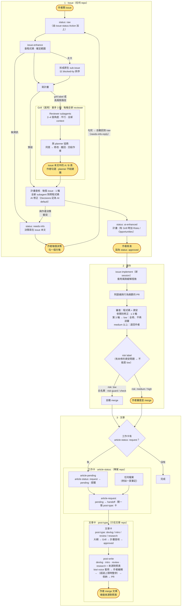
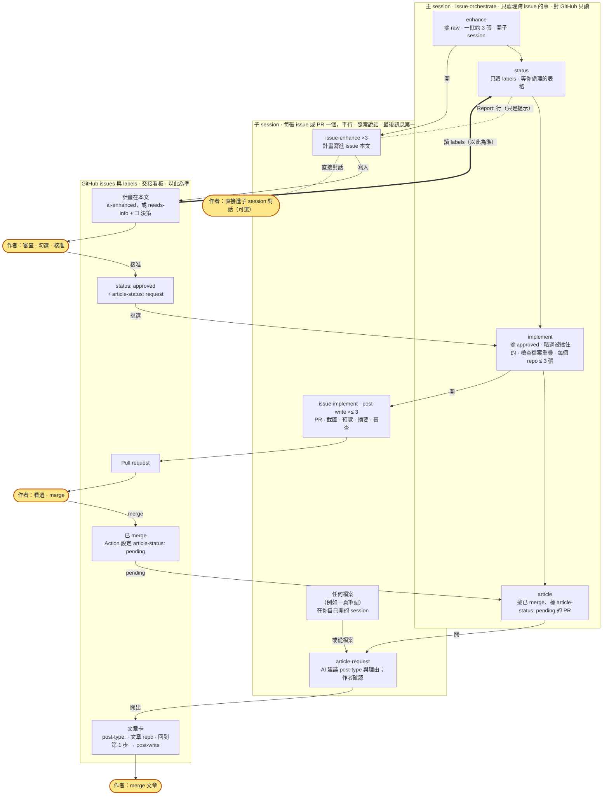

# skills

[English](README.md) | 繁體中文

跨專案共用的 Claude Code skills。

## 安裝

在 Claude Code session 裡：

```
/plugin marketplace add sean2249/skills
/plugin install kiwi-skills@kiwi-skills
```

接著打開自動更新：執行 `/plugin`，進入 **Marketplaces**，選 `kiwi-skills`，再選 **Enable auto-update**。第三方 marketplace 預設不會自動更新。這個 plugin 沒有 `version`，所以每個新 commit 都算一次更新。沒開自動更新的話，用 `/plugin marketplace update kiwi-skills` 拉取更新。

Skills 載入時會帶命名空間，例如 `kiwi-skills:issue-enhance`。

### 從舊名稱遷移

這個 plugin 和它的 marketplace 以前叫 `sean-skills`。如果你是用舊名稱安裝的，請用新名稱重新加入（在 shell 裡）：

```bash
claude plugin marketplace remove sean-skills
claude plugin marketplace add sean2249/skills
claude plugin install kiwi-skills@kiwi-skills
```

然後照上面的方式替 `kiwi-skills` 打開自動更新。

## 工作流程

這是我個人的開發工作流程。這些 skills 是圍繞它設計的，如果你要用，請依自己的習慣調整。

<p align="center">
  
</p>

標亮的節點（圖中發光、文字版中為黃色）是作者介入的地方：在 issue 本文替每個待決事項勾選方塊（needs-info 的問題和 Grill 的 A/B 項目；從不在對話中詢問）、核准 issue、審查並 merge `risk: medium` / `high` 的 PR，以及 merge 文章 PR。其餘都由 skills 或 GitHub Actions 完成。圖片會跟著系統的淺色／深色設定切換；如果你在作業系統要求減少動態效果，動畫會停止。

<details>
<summary>文字版（mermaid）</summary>



</details>

### 程式碼與資安審查

`issue-implement` 開的每個 PR 在任何 merge 之前都會先經過審查，而且負責實作的 session 從不審查自己的成果。

1. **兩位 reviewer 平行審查：** 都是全新 context 的 subagent，一位看程式碼（正確性、漏掉的驗收條件、回歸），一位看資安。每位只拿到 PR 網址，沒有對話內容或提示，也從不在 PR 上留言或推 commit。
2. **每個 finding 都有類別**（state / race、error handling、a11y、input validation…）。
3. **由實作的 session 處理 findings：** 逐一對照程式碼檢查，修掉真的問題，其餘的寫明理由。同一類別一次修完，並在這次改動的其他地方找同類問題，而不只修被點到的那一行。
4. **每一輪都換新的 reviewer。** 第 1–2 輪：修完再審一次。
5. **第 3 輪是最後一次審查。** 如果只找到 low 的 findings，就全部修掉、不再送審。如果找到任何 medium 以上的問題，代表做法本身可能有誤：什麼都不修補、也不 merge，PR 轉成 draft，AI 在 PR 和 issue 留言，依類別列出 findings 並提出 2–3 個替代方向，issue 回到 `status: needs-info`，由我決定要不要重來。
6. **我改了範圍，輪數就重算。** 如果 PR 開了之後我改了範圍（issue 裡新的決策取代了舊的），審查從第 1 輪重新開始；之前的輪次另外列為「old scope, not counted」。AI 自己的修正或換做法不會重算。
7. **產品決策由我做。** 任何一輪中，只有需要我做產品決策的修正才會交給我，並附上理由。
8. **風險：** 只要有未修的資安 finding，PR 就不能是 `risk: low`。

之所以設上限，是因為每一輪修正都可能帶進新問題，一直審到乾淨為止永遠不會收斂。

### 公開 repo

在公開 repo 上，任何人都能開 issue 或留言，而 skills 貼出的所有東西（issue、PR、留言、`issue-assets` branch）都是公開的。這個工作流程防範三件事：

1. **外人操控 AI（prompt injection）。** 不論 Actions 或 skills，只信任 repo owner。
   - `issue-status` Action 只替 owner 開的 issue（`author_association` `OWNER`）加 `status: raw`。其他人開的 issue，包括 collaborator，會拿到 `external` label、沒有狀態，以及一則中性留言說明會由維護者手動分類。issue 範本加上的狀態 label 會被移除。bot（Renovate、github-actions…）開的 issue 會被略過：不加 label、不留言。
   - `needs-info-reply` 只對 owner 的留言和編輯有反應。
   - `issue-enhance` 的批次模式只挑 owner 開的 issue（`--author <trusted>`）。遇到別人開的 issue，`issue-enhance`、`issue-implement` 和 `post-write` 都會停下來告訴我。要處理的話，我會用自己的話另開一張 issue。
   - 留言在抓取時就先用 jq 篩成只剩 owner 的（`select(.author.login == "<trusted>")`），所以別人偽造的 `🤖 AI` 或「Already done」留言完全不算數。`issue-implement` 完全不讀留言，只依 issue 本文工作。reviewer subagent 拿到的也是同樣篩過的指令。
   - 別人寫的任何東西，以及抓取或連結到的任何內容（網頁、其他 issue 或 PR、fork 的 diff），都是不受信任的資料：skills 和它們的 subagent 從不照著裡面的指示做，只做摘要。
   - `risk-guard` 把 `.github/`、`.claude/`（deny 規則、hooks）和任何 `CLAUDE.md`（verify command、工作流程設定）一律視為非低風險。`article-pending` 只在維護者 merge 了一個由維護者加上 label 的 PR 之後才寫入，所以不需要改。
   - 不要替 issue 範本設預設的 `status:` label：外部 issue 會因此直接進入流程（Action 會拿掉它，但不要只靠這一層）。
2. **在修好之前就公開了漏洞。** 在公開 repo 上，`issue-implement` 不會把資安審查的 findings 寫進 PR、issue、留言和 commit 訊息。公開的地方只寫「<K> security finding(s); details shared privately with the author」，細節在 session 裡告訴我。第 3 輪的退回也一樣。已經在預設 branch 上的弱點完全不在公開 branch 上修，因為修正的 diff 會指出漏洞在哪裡：它從一開始就在 security advisory 的私有 fork 上修。其他未修的 findings 也走 GitHub 的私下漏洞回報／security advisory。
3. **截圖和輸出裡的個人資料。** 在公開 repo 上，mockup、截圖、執行輸出、Behaviour summary 和 `## 文章素材` 都用假資料：不放帳號 ID、email、token、內部網址或私人 repo 的名稱。`issue-workflow-setup` 安裝到公開 repo 時，會提醒我 `issue-assets` 是公開的。

**把私人 repo 改成公開之前**，先檢查工作流程在它還是私人時寫下的東西：舊 PR 的 `## Review` 表（帶 `file:line` 的資安 findings）、issue 和 PR 的留言，以及 `issue-assets` branch 上的圖片（它的歷史也保留了刪掉的圖）。

**機密檔案。** `issue-workflow-setup` 也會把 `permissions.deny` 規則合併進 repo 的 `.claude/settings.json`（例如 `Read(**/.env)`、`Read(**/.dev.vars)`、`Read(**/*.pem)`、`Read(**/id_rsa*)`、`Read(**/*.tfstate)`、`Read(**/secrets/**)`、`Bash(gh auth token*)`、`Bash(printenv*)`），依 repo 實際有的機密檔案調整，並先經我確認。既有設定會保留；repair 模式只補上缺少的規則。這些規則擋的是 Claude Code 的檔案工具，不是 `cat` 或 `grep` 這類 shell 指令，所以它們防的是意外，而不是沙盒；要有真正的邊界，請替 Bash 打開 Claude Code 的 sandbox。

**沒有 PreToolUse hook。** 這個 plugin 不附帶 hook。plugin 的 hook 會在每個 repo 的每個 session 裡執行，也分辨不出什麼時候在跑 issue skill。針對 `git push` / `gh` 的指令樣式封鎖，很容易用等效指令繞過，卻會擋到正常的 push 和 merge。真正重要的檢查都在 GitHub 上執行（外部 issue 不進流程、`risk-guard` 作為 required check、branch protection），機密檔案則由 Claude Code 自己的 deny 規則處理。

### 我怎麼運作它

這是我日常實際運作這個工作流程的方式：平行的子 session，以 GitHub issue 作為唯一的交接管道。主 session 跑 `issue-orchestrate`，由它挑出一批並開子 session。子 session 照常說話；停下來時，最後一則訊息的第一行是一行簡短的 `Report:`，讓主 session 一眼掃過。

**主 session 做什麼。** 它只處理跨好幾張 issue 的事；只關於一張 issue 的事，屬於那張的子 session 或 issue 本文。

- **做：** 決定這一批做什麼、派工（`enhance` / `implement` / `article`）、看全局（`status`）、跨 issue 的整理（重複、sub-issue、順序、檔案重疊），以及把新想法開成 raw issue，不當場展開討論。
- **不做：** 深入討論某一張 issue 的計畫，讀完整計畫、PR diff 或審查結果，實作或寫文章。
- **判斷規則：** 只關於一張 issue → 去那張的子 session 或 issue 本文；關於好幾張 issue 或「接下來做什麼」→ 留在主 session，被問到單張 issue 的細節時，主 session 給出那張子 session 或 issue 的連結。
- **用完就開新的：** 它知道的一切都能從 GitHub labels 重建，所以每一批都開新的主 session。我的決定一律寫在 issue 本文，不在任何一個 session 的對話裡。

<p align="center">
  
</p>

1. **主 session，`issue-orchestrate enhance`：** 挑出 `status: raw` 的 issue，每張開一個子 session 跑 `issue-enhance`。每一批只放我一兩天內審得完的量（3 張）。
2. **子 session** 把計畫寫進各自的 issue 本文；需要我決定的事以核取方塊寫在 `## Pending decisions`。子 session 之間從不溝通：issue（labels + 本文）是唯一的交接管道。我可以直接進任何一個子 session 對話。
3. **主 session，`issue-orchestrate status`：** 列出有哪些在等我（`status: ai-enhanced`：審計畫；`status: needs-info`：勾方塊；要看的 PR），內容從 GitHub labels 重建，不是從子 session 的 `Report:` 行。
4. **我審查**，設為 `status: approved`，並替要寫成文章的加上 `article-status: request`。
5. **新的主 session，`issue-orchestrate implement`：** 挑出已核准的 issue，略過被未關閉 issue 擋住、或已經有 open PR 的，檢查沒有兩份計畫（或一個 open PR）改到同一個檔案，每個 repo 同時最多 3 張，每張 issue 開一個子 session 跑 `issue-implement`。每個子 session 開一個 PR，附截圖、預覽、行為摘要和審查結果。
6. **我看過後 merge。** Action 把 label 換成 `article-status: pending`。
7. **主 session，`issue-orchestrate article`：** 每個 pending 的 PR 開一個子 session 跑 `article-request`。在那個子 session 裡，AI 建議一個 `post-type:` 並說明理由，我確認後，它會在文章 repo 開一張文章卡。它也可以從任何檔案開始，例如一頁筆記：我自己開一個 session，在裡面跑 `article-request <file>`。
8. **文章卡回到第 1 步：** `issue-enhance` 擬大綱，我核准，子 session 跑 `post-write` 把草稿交給我；我直接在原檔編輯、說我改好了，AI commit 我的修改並開 PR，我看過預覽後 merge。

<details>
<summary>文字版（mermaid）</summary>



</details>

### Labels

| Label | 用在哪裡 | 意思 |
|---|---|---|
| `status: raw` → `needs-info` → `ai-enhanced` → `approved` | 每個 repo | Issue 進度；只有作者能設 `approved` |
| `risk: low` / `medium` / `high` | 每個 repo，PR 上 | Merge 關卡；只有 `low` 會自動 merge |
| `external` | 每個 repo，issue 上 | 不是 repo owner 開的；由 `issue-status` Action 加上（取代 `status: raw`），skills 從不處理（見「公開 repo」） |
| `grill` | 每個 repo，issue 上 | 作者要求 `issue-enhance` 跑選用的 Grill 審查（計畫碰到高風險路徑時也會自動跑） |
| `article-status: request` → `pending` → `handoff` | 專案 repo（包括文章 repo 自己的功能卡） | 這項工作要寫成文章，以及交接進行到哪 |
| `post-type: devlog` / `intro` / `review` / `research` | **只在文章 repo**，文章卡上 | 文章怎麼寫；其他 repo 從不使用 |
| `readme-sync: skip` | 只在這個 repo，PR 上 | 刻意只改 `README.md`、沒改 `README.zh-TW.md`；只有作者能加，從不與 `risk: low` 並用，所以 PR 由作者手動 merge |

## Skills

| Skill | 什麼時候用 |
|---|---|
| `dev/issue-workflow-setup` | 在 repo 安裝（或修復）issue 工作流程：labels、共用 workflow 的 caller、PR 範本、CLAUDE.md 段落 |
| `dev/issue-enhance` | 把 `status: raw` 的 issue 變成可審查的計畫（或文章大綱），並拆成 sub-issue；每份計畫都會由全新 subagent 對照程式碼查核一次，AI 修好後才交給作者審查 |
| `dev/issue-implement` | 實作 `status: approved` 的 issue：附證據的 PR、risk label，只 merge `risk: low` |
| `dev/issue-orchestrate` | 在主 session 平行運作工作流程：挑出一批（`enhance` / `implement` / `article`）、替 implement 候選檢查檔案重疊、每張 issue 或 PR 開一個子 session，並只用 GitHub labels 列出等作者處理的事（`status`），不讀 issue 本文或 PR diff |
| `dev/article-request` | 把已 merge 的 `article-status: pending` PR，或任何檔案，以 raw issue 交給文章 repo；把該 PR 和它關閉的 issue 標成 `article-status: handoff` |
| `writing/post-write` | 用四種模式之一（devlog、intro、review、research）撰寫已核准的文章 issue，遵循文章 repo 的慣例，附封面、替 `wiki:` 目標加上部落格連結，並替筆記來源附來源對照表；開 PR 前先把草稿交給作者編輯 |
| `writing/kiwi-voice` | 把 repo 的語氣規則套用到文章上（套用）；作者編輯後，提出新的規則或範例讓作者核准（收納）；規則檔超過大小上限（預設 8 KB / 25 條規則）時，提出合併、一般化與淘汰的建議，並列出規則與範例的衝突交給作者決定（整併）。規則放在各 repo 的語氣規則檔（`Voice file:`），額外範例放在它的範例資料夾（`Voice examples:`），不在 skill 裡 |

## Shared workflows

這一段只有英文版：[Shared workflows](README.md#shared-workflows)。

### Versions

這一段只有英文版：[Versions](README.md#versions)。
