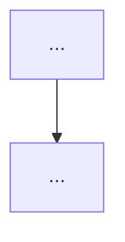

# issue-enhance

Turns a raw issue into a plan a fresh session can implement without this conversation. Requires the repo to have been set up with `issue-workflow-setup`.

## Hard rules

- **Never add `status: approved`.** Only the author sets it — even if asked to "finish" or "complete" the issue. Say so and stop.
- **Keep the author's original text verbatim.** Never rewrite or delete it.
- **One AI section in the body, always overwritten.** Everything you write goes below `---` and the `> 🤖 AI-enhanced (Claude Code), <YYYY-MM-DD>` header. It is the latest complete plan: each revision replaces that whole section; never stack a second one. The implementing session reads only the body.
- **One AI comment per body change.** Every time you change the body (Step 5 first enhancement, each Step 5b grill round, each Step 5c revision, Step 6 split, Step 7 rejection) or ask needs-info questions (Step 3), post a `gh issue comment` whose first line is `🤖 AI <YYYY-MM-DD>`, followed by what changed this round and why. Other AI comments (e.g. already-done evidence) use the same first line. The author's comments have no prefix, so any comment not starting with 🤖 is the author's.
- **Why markers:** the AI posts with the author's `gh` login, so GitHub's author field can't tell AI from author; only these fixed markers can.
- **Don't close issues on your own judgement.** Closing happens only when the author has rejected an idea in this session (see Step 7).

## Step 0 — Pick the issues

```bash
# one issue
gh issue view <N> --json number,title,body,labels,comments
# batch: every raw / needs-info issue, minus those already answered with an "Already done" comment
# the author hasn't replied to. Filter --json locally (`--label` uses the search index, which lags).
gh issue list --state open --limit 500 --json number,title,labels,comments --jq '
  .[] | select([.labels[].name] | index("status: raw") or index("status: needs-info"))
  | select((.comments[-1].body // "") as $b | ($b | startswith("🤖 AI")) and ($b | contains("**Already done**")) | not)
  | "#\(.number) [\(.labels | map(.name) | map(select(startswith("status: "))) | join(","))] \(.title)"'
```

The filter skips issues whose **latest** comment is the AI's "Already done" evidence (Step 1). They wait for the author to close them. Any newer author comment brings the issue back into the batch. Normally an author's reply on a `needs-info` issue switches it back to `status: raw` automatically (the `needs-info-reply` workflow). The `needs-info` branch of the filter is a fallback for when that workflow didn't run: such an issue is only worth picking up when the author has replied after the AI's question.

In batch mode, list them all first, then enhance one at a time, finishing each (label changed) before starting the next.

Read the repo's `CLAUDE.md` `## Issue workflow` section for the verify command, preview URL, issue assets branch, and `Mockup path` (default `<N>/<file>`).

## Prerequisite — gh version

`gh issue create --help | grep -q -- --parent || echo "gh too old: upgrade gh for --parent / --blocked-by"`. If it's too old, ask the author to upgrade `gh` (don't do it for them) and stop.

## Step 1 — Check the code first

For an **article-writing issue**, skip to Step 5a: one with any `article-type:` label (`devlog` / `intro` / `review` / `research`). An `article-status: request` label in a project repo only means "write an article after this ships"; that issue gets the normal plan.

Search the codebase for what the issue asks for. There are three outcomes:

- **All done** → post the "Already done" comment below with `Not done: nothing`. Leave the label and the closing to the author, then stop. Batch mode skips the issue from now on (Step 0).
- **Partly done** → post the same comment, listing what's left under `Not done`. Then plan **only the remaining part** (Steps 2–5). If the remaining part is really a different piece of work, ask the author (Step 3) whether to open it as a new issue rather than keep it here.
- **Not done** → continue with Step 2.

"Already done" comment, fixed format, so Step 0 and the author can recognise it:

```markdown
🤖 AI <YYYY-MM-DD>
**Already done**

- <what the issue asked for> — `path/to/file.ext:123`, <commit sha or PR url>
- …

Not done: <what the issue asked for that isn't there, or "nothing">

If this matches what you meant, please close the issue yourself; the AI doesn't close issues.
```

## Step 2 — Is it one vertical slice?

One issue = one vertical slice a single fresh session can finish (implement, verify, open PR).

- **Several unrelated ideas in one issue** → one sub-issue per idea (Step 6); the original becomes the parent.
- **One idea, too big for one session** → ordered sub-issues, each later one **blocked by** the one before (native dependency, Step 6). Don't write `Blocked by #N` in the body.

## Step 3 — Blocked on a specific question?

If you cannot write the plan without an answer only the author has:

**Author in the session** → ask them directly, in chat. Write the answer into the body's **Decisions** as `<YYYY-MM-DD> — <decision> — (author)` and mention it in this round's 🤖 comment. No label change.

**Author not present** (e.g. batch run) → ask on the issue:

```bash
gh issue comment <N> --body-file <questions.md>
gh issue edit <N> --remove-label "status: raw" --add-label "status: needs-info"
```

The comment starts with `🤖 AI <YYYY-MM-DD>`. Questions must be specific and answerable: numbered, each with the options you see and your recommendation. "Please provide more information" is not allowed. Stop here for this issue.

## Step 4 — UI work and open choices: options side by side

**Settle scope first.** Don't draw anything until the code has been checked (Step 1) and every question that changes the scope is answered (Step 3), e.g. "should the remaining part be done here at all?". Mockups for a scope that later changes are wasted work.

For any UI change, or any choice that isn't settled yet, show **2–3 versions side by side in the same round** and ask the author to pick one (multiple choice) **before** writing the plan. Never one version per round: the author should see the failures and the compromises together. Only the chosen option goes into the issue.

**375px screenshots (UI).** Render each version (an HTML mockup, or the running app) at phone width into a temp dir outside the repo:

```bash
shots=$(mktemp -d)
npx -y playwright install chromium            # first time only
npx -y playwright screenshot --viewport-size=375,812 --full-page "file://$PWD/mockup-a.html" "$shots/a.png"
npx -y playwright screenshot --viewport-size=375,812 --full-page "<preview url>" "$shots/b.png"
# alternative without Playwright (Chrome/Chromium on PATH):
#   chromium --headless --hide-scrollbars --window-size=375,812 --screenshot="$shots/a.png" "file://$PWD/mockup-a.html"
```

Keep the mockup HTML files in that temp dir too, not in the repo.

**Show the images, then ask.** A multiple-choice question can't display images. First show the screenshots: send them as files in the chat if your client can, or upload them (below) and paste the links. Then ask the multiple-choice question referring to them as A / B / C.

**Store images on the `issue-assets` branch:** never merged, never on a public CDN. Upload from a temp clone outside the repo and outside any worktree. This works with any git version (no `worktree add --orphan`, which needs git ≥ 2.42):

```bash
tmp=$(mktemp -d)
git -C "$tmp" init -q
git -C "$tmp" remote add origin "$(git remote get-url origin)"
git -C "$tmp" symbolic-ref HEAD refs/heads/issue-assets
git -C "$tmp" fetch -q --depth 1 origin issue-assets 2>/dev/null && git -C "$tmp" reset -q --hard FETCH_HEAD
# <dest> = `Mockup path` from CLAUDE.md with <N> and <file> filled in (default: <N>/<file>)
mkdir -p "$tmp/$(dirname <dest>)"
cp "$shots/a.png" "$tmp/<dest>"
git -C "$tmp" add -A && git -C "$tmp" commit -q -m "Mockups for #<N>"
git -C "$tmp" push -q origin issue-assets
rm -rf "$tmp"
```

Reference them as `https://github.com/<owner>/<repo>/blob/issue-assets/<dest>?raw=true` (works for private repos when the viewer is logged in). Delete `$shots` once the chosen image is in the issue.

## Step 5 — Write the enhanced body

Write the AI section below the original text; on later revisions, replace the existing AI section (from `---` + the 🤖 header to the end) instead of adding another. Write prose in the issue's language; keep the headings as-is so other skills can find them.

````markdown
<original author text, untouched>

---

> 🤖 AI-enhanced (Claude Code), <YYYY-MM-DD>. Waiting for author review.

## Current state
- What exists today, each point with `path/to/file.ext:123`.

## Conditions the description left out
- Conditions this enhancement added that the author's original text didn't state (edge cases, constraints, defaults). The author uses this list to practise writing a more complete first description.

## Decisions
- <YYYY-MM-DD> — <decision> — <why>. (Mark which ones the author made vs. AI defaults.)

## Risks
- <risk> — likelihood / impact: <low|med|high> / <low|med|high> — mitigation: <what the implementation must do> — author: <accepted / changed to …> (<YYYY-MM-DD>)

## Opportunities
- <potential upside> — cost: <rough size> — author: <this time / later / new issue #N> (<YYYY-MM-DD>)

## Approach
- Ordered steps a fresh session can follow.

## Flow


## Mockup
<chosen option image; UI issues only>

## Acceptance criteria
- [ ] Observable behaviour, testable by a person or a command. Not file paths.

## Verification
- Commands: `<verify command from CLAUDE.md>`, plus any targeted test.
- Manual: <steps on the preview URL or locally>.
````

**Validate mermaid before posting.** Render it locally and fix errors:

```bash
npx -y @mermaid-js/mermaid-cli -i flow.mmd -o flow.svg
```

The first run downloads a headless browser and can take a minute or two; that's normal. Write `flow.mmd` / `flow.svg` to a temp dir, not the repo.

Then write the body and comment, and go on to the grill (Step 5b). Only after the grill does the label move:

```bash
gh issue edit <N> --body-file <body.md>
gh issue comment <N> --body "🤖 AI <YYYY-MM-DD>

<what this round added or changed, and why>"
# after Step 5b finishes:
gh issue edit <N> --remove-label "status: raw" --remove-label "status: needs-info" --add-label "status: ai-enhanced"
```

## Step 5a — Article issues: an outline, not an implementation plan

An article-writing issue (see Step 1) gets an article outline. Read only the sources listed in its `## Sources` section (see `article-write` Step 2 for how). Never search a source repo for other files. If it has more than one `article-type:` label, ask the author which one applies and remove the others.

Same rules as Step 5 (author text untouched, one AI section, 🤖 comment), with this AI section:

````markdown
---

> 🤖 AI-enhanced (Claude Code), <YYYY-MM-DD>. Waiting for author review.

## Mode
One of: `article-type: devlog` (reconstruct a decision path), `article-type: intro` (introduce a tool / concept / site), `article-type: review` (the author's take on a work), `article-type: research` (a topic exploration, reasoning kept).

## Main thread
- The one thread the article follows, in a sentence or two.

## Sections
1. <section>: <what it says>. Material: <which source / which part of 文章素材>.

## Not writing
- What is deliberately left out, and why.

## Source map
<!-- Required when a source is a note-like file: always for review / research, and for intro from a file. -->
| Source section / point | Goes to section | If left out: why |
|---|---|---|
| <heading or point> | <outline section #> | |
| <…> | — | duplicate / only meaningful to the author / internal link / … |

## Risks
- <risk, e.g. misrepresenting the author's view> — likelihood / impact — mitigation — author: <decision> (<date>)

## Opportunities
- <upside, e.g. a follow-up piece> — cost — author: <this time / later / new issue> (<date>)

## Conditions the description left out
- …

## Acceptance criteria
- [ ] Reader-level outcomes (e.g. "a reader new to X can say what it does after the first section").

## Verification
- Build/preview per the article repo's `## Article conventions`.
````

For note-like sources, list **every** source section in the source map, so the author sees what's kept and dropped before approving. `review` and `research` outlines keep the author's evaluations and line of reasoning as sections; don't reduce them to a summary.

Then write the body and comment as in Step 5, grill it (Step 5b), and only then move the label to `status: ai-enhanced`.

## Step 5b — Grill (last step before `status: ai-enhanced`)

Pressure-test the plan from 2–4 professional angles to surface risks, upsides, and missing decisions **before** the author approves. **You don't review your own plan.** Each angle is reviewed by a fresh-context subagent that sees only the issue and the repo.

**1. Pick 2–4 angles** that fit the issue, and name them in the round's comment:

| Issue type | Angles to pick from |
|---|---|
| UI | UX, accessibility, mobile / small screens, visual consistency |
| Backend / data | data integrity, security, performance, operations (deploy, rollback, monitoring) |
| Infra / CI | blast radius, rollback, secrets, cost |
| Article (outline) | editor (structure, clarity), target reader, fidelity to sources |

**2. Dispatch one reviewer per angle, in parallel.** The issue body must already be updated (Step 5 / 5a). In **one message**, launch one subagent per angle (Agent tool, `general-purpose`). Give each **only** the prompt below: no conversation, reasoning, drafts, or hints about what you think is weak.

```text
You are reviewing a GitHub issue's implementation plan as a <angle> expert.
Issue: <issue url>   Repo: <local path, or <owner>/<repo>>
Read it yourself: `gh issue view <issue url> --comments`. The author's original text is above
`---`; the AI plan is below it. Look up anything factual yourself in the code, docs, or data.
Find as many problems with the plan as you can from the <angle> angle. Do not contact the
author, comment on the issue, or change any file.
Return exactly:
## Questions
1. <question>
   - Why: <the risk it guards against / upside it unlocks / decision that's missing>
   - Type: risk | opportunity | missing decision
   - Severity / value: high | medium | low
   - Suggested answer: <your recommendation>
## Unclear or missing in the body
- <what an implementing session would get stuck on>
Facts you could look up are not questions; state what you found instead.
```

For an article outline, the reviewer reads the outline and the listed sources (the outline is the "plan").

**3. Negotiate with each reviewer, in the same round.** For every item a reviewer returned, respond:

- **Agree** → change the plan.
- **Rebut** → only with evidence: a code location (`file:line`), an earlier author decision, the issue's original text, or docs.
- **Preference** → a trade-off that belongs to the author; mark it for the author.

Send your responses back to the **same** subagent with `SendMessage`, reusing its context (don't start a new one). Ask it to answer item by item: withdraw if persuaded, explain if not, and end with a final position on each item. **At most 2 exchanges per reviewer.** Every item ends in one of three buckets:

| Bucket | What happens |
|---|---|
| **Agreed change** (both sides) | Change the plan directly. |
| **Withdrawn** after your rebuttal | No change. Listed in the round's comment with the reason, so the author can overturn it. |
| **For the author** (still disputed, or a preference / trade-off) | Goes to the author (step 4). |

Items under **Unclear or missing in the body** aren't negotiated: fix the body directly. If a reviewer fails mid-negotiation, every item it hasn't settled goes to **For the author**.

**4. Ask the author, only the "For the author" bucket**, deduplicated across reviewers and sorted by severity / value. Every item uses this fixed, symmetric format. Write it in the issue's language and keep the structure:

```markdown
### Decision <N>: <short name>

Point of disagreement: <one sentence: what the two sides disagree about>

| | A (reviewer: <angle>) | B (planner: main agent) |
|---|---|---|
| Claim | | |
| Reasoning | | |
| Evidence | <file:line, docs, issue text… or "no direct evidence"> | <… or "no direct evidence"> |
| If this side is chosen | <cost, risk, extra work> | <cost, risk, extra work> |

Agreed: <what both sides already agree on, or "none">

Options: A / B / other
```

- A and B sit side by side, and all eight cells are filled. Missing evidence is written as "no direct evidence", never left blank.
- No line breaks inside a cell. Keep each cell to one or two sentences, and put details in footnotes under the table (`[^1]` in the cell, `[^1]: …` below).
- **No recommended answer from you.** You are side B, so a recommendation wouldn't be neutral.
- A pure preference with no dispute uses the same table, with the column headers "Option one" / "Option two", each with its consequences.
- **Author in the session** → show these items, table included, directly in chat. **Author not present** (e.g. batch mode) → post them as a `status: needs-info` comment (labelling as in Step 3), in this same table format, and stop. The next run picks the grill up from the author's reply.

**5. Write answers back into the AI section** of the body, then comment:

- `## Decisions`: `<YYYY-MM-DD> — Decision <N>: chose A / B / other: <what> — (author)`.
- `## Risks`: each risk with likelihood / impact, the mitigation, and the author's decision.
- `## Opportunities`: each upside with its cost and the author's call: **this time** (add it to Approach and Acceptance criteria), **later** (keep listed), or **new issue** (open it as a sub-issue or a separate issue, per Step 6).
- One `🤖 AI <YYYY-MM-DD>` comment per round, listing all three buckets: **changed** (what was changed in the plan), **withdrawn** (each with its reason, so the author can overturn it), and **asked** (the decisions and the author's choices), plus any angle that went **unreviewed**. To overturn a withdrawn item, the author replies to it, and the next round takes it up.

**6. Next round, fresh reviewers.** Dispatch **new** subagents against the updated body. Negotiation reuses a reviewer's context only within its own round; never carry a reviewer over to the next round. **Stop** when the reviewers raise nothing new, or the author says it's enough. **At most 3 rounds**; a small issue (one slice, no UI choice, no data change) gets **one** round.

**7. A reviewer fails or times out** before returning anything → mark that angle as unreviewed in the round's 🤖 comment and carry on. It doesn't block the flow.

When the grill ends, move the label to `status: ai-enhanced` (Step 5).

## Step 5c — Author asks for changes

When the author asks for changes after seeing mockups or the enhanced issue:

1. Revise the plan.
2. If it's a choice, show a new set of options side by side (Step 4).
3. Add any new condition the author supplied this time to **Conditions the description left out**.
4. Overwrite the AI section of the body with the full revised plan (`gh issue edit <N> --body-file <body.md>`); the author's text stays untouched.
5. Post a comment starting `🤖 AI <YYYY-MM-DD>`: what changed this round and why.
6. Keep the label at `status: ai-enhanced`.

## Step 6 — Splitting into sub-issues

Create each slice as a native sub-issue of the original, and express order as native dependencies:

```bash
# first slice
gh issue create --parent <original> --title "<slice 1>" --body-file <slice1.md> --label "status: ai-enhanced"
# later slice, blocked by the previous one
gh issue create --parent <original> --blocked-by <slice1> --title "<slice 2>" --body-file <slice2.md> --label "status: ai-enhanced"
# existing issues: attach / add a dependency after the fact
gh issue edit <original> --add-sub-issue <A>,<B>
gh issue edit <B> --add-blocked-by <A>
# undo: --remove-sub-issue <A> / --remove-blocked-by <A>
# check
gh issue view <N> --json parent,subIssuesSummary,blockedBy,blocking
```

Each child body is all AI-written, so it starts with the 🤖 header and follows the Step 5 template. The parent/child link and the dependencies live in GitHub, not in the text: no `Part of #N`, no `Blocked by #N`, no `## Slices` checklist.

The original becomes the parent: keep the author's text, label it `status: ai-enhanced`, and comment `🤖 AI <YYYY-MM-DD>` with the split and the reason. A parent has no acceptance criteria of its own and isn't implemented directly. Its progress is the sub-issue summary.

## Step 7 — Author rejects an idea

When the author rejects an idea in the session, record the reason in one comment and close it:

```bash
gh issue close <N> --reason "not planned" --comment "🤖 AI <YYYY-MM-DD>

Rejected by the author on <YYYY-MM-DD>: <their reason, in their words>."
```

## Done when (per issue)

- [ ] Either: the fixed-format "Already done" comment (all done); or that comment **plus** a plan for the rest (partly done); or `status: needs-info` with specific questions; or `status: ai-enhanced` with every section filled (Mockup only for UI; article issues use the Step 5a outline).
- [ ] Questions answered in the session are in **Decisions**, marked `(author)` with the date.
- [ ] Splits are native sub-issues; order is native blocked-by; no `Blocked by #N` / `## Slices` text.
- [ ] Original text is intact; exactly one AI section, below `---` and the 🤖 header.
- [ ] Every body change has a matching `🤖 AI <date>` comment saying what changed and why.
- [ ] **Conditions the description left out** lists every condition you added.
- [ ] Scope was settled before any mockup; open choices were shown as 2–3 versions side by side (UI: 375px screenshots, shown before the question); no temp files left in the repo.
- [ ] Mermaid rendered without errors.
- [ ] Grill ran with fresh-context subagents, one per angle (2–4), dispatched in parallel and new each round (≤ 3 rounds, one for small issues).
- [ ] Each reviewer's items were negotiated (≤ 2 exchanges, same subagent) into agreed / withdrawn / for-the-author; only the last went to the author, as side-by-side A/B tables with every cell filled and no recommendation from you.
- [ ] Answers are in Decisions (A / B / other + date) / Risks / Opportunities; unclear-body items were fixed; each round's 🤖 comment lists changed, withdrawn (with reasons), asked, and unreviewed angles.
- [ ] No `status: approved` added.
