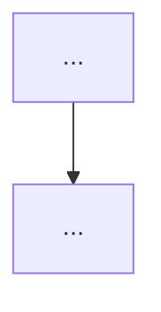

# issue-enhance

Turns a raw issue into a plan a fresh session can implement without this conversation. Requires the repo to have been set up with `setup-issue-workflow`.

## Hard rules

- **Never add `status: approved`.** Only the author sets it — even if asked to "finish" or "complete" the issue. Say so and stop.
- **Keep the author's original text verbatim.** Add to it; never rewrite or delete it.
- **Every comment you post starts with** `> 🤖 AI-generated (Claude Code)` on its own line.
- **Don't close issues on your own judgement.** Closing happens only when the author has rejected an idea in this session (see Step 7).

## Step 0 — Pick the issues

```bash
# one issue
gh issue view <N> --json number,title,body,labels,comments
# batch: every raw issue, plus needs-info issues where the author replied after the AI's question
gh issue list --state open --label "status: raw" --json number,title --limit 100
gh issue list --state open --label "status: needs-info" --json number,title --limit 100
```

In batch mode, list them all first, then enhance one at a time, finishing each (label changed) before starting the next.

Read the repo's `CLAUDE.md` `## Workflow` section for the verify command, preview URL, and issue assets branch.

## Step 1 — Check the code first

Search the codebase for what the issue asks for. If it is **already done**, comment with the evidence (file:line, commit) and tell the author it can be closed. Leave the labels and the closing to them. Stop.

## Step 2 — Is it one vertical slice?

One issue = one vertical slice a single fresh session can finish (implement, verify, open PR).

- **Several unrelated ideas in one issue** → open one issue per idea (Step 6) and turn the original into an overview.
- **One idea, too big for one session** → split into ordered slices. Each later slice says `Blocked by #<N>` in its body.

## Step 3 — Blocked on a specific question?

If you cannot write the plan without an answer only the author has:

```bash
gh issue comment <N> --body-file <questions.md>
gh issue edit <N> --remove-label "status: raw" --add-label "status: needs-info"
```

Questions must be specific and answerable: numbered, each with the options you see and your recommendation. "Please provide more information" is not allowed. Stop here for this issue.

## Step 4 — UI work and open choices: options side by side

For any UI change, or any choice that isn't settled yet, show **2–3 versions side by side in the same round** and ask the author to pick one (multiple choice) **before** writing the plan. Never one version per round: the author should see the failures and the compromises together. For UI, attach a 375px-wide screenshot of each version. Only the chosen option goes into the issue.

Store images on the repo's `issue-assets` branch: never merged, never on a public CDN.

```bash
git fetch origin issue-assets 2>/dev/null \
  && git worktree add ../.issue-assets issue-assets \
  || git worktree add --orphan -b issue-assets ../.issue-assets
mkdir -p ../.issue-assets/<N>
cp <mockup>.png ../.issue-assets/<N>/
git -C ../.issue-assets add <N> && git -C ../.issue-assets commit -m "Mockups for #<N>"
git -C ../.issue-assets push -u origin issue-assets
git worktree remove ../.issue-assets
```

Reference them as `https://github.com/<owner>/<repo>/blob/issue-assets/<N>/<file>.png?raw=true` (works for private repos when the viewer is logged in).

## Step 5 — Write the enhanced body

Append below the original text. Write prose in the issue's language; keep the headings as-is so other skills can find them.

````markdown
<original author text, untouched>

---

> 🤖 AI-enhanced (Claude Code), <YYYY-MM-DD>. Waiting for author review.

## Current state
- What exists today, each point with `path/to/file.ext:123`.

## Conditions the description left out
- Conditions this enhancement added that the author's original text didn't state (edge cases, constraints, defaults). The author uses this list to practise writing a more complete first description.

## Decisions
- <YYYY-MM-DD> — <decision> — <why>. (Mark which ones the author made vs. AI defaults.)

## Approach
- Ordered steps a fresh session can follow.

## Flow


## Mockup
<chosen option image; UI issues only>

## Acceptance criteria
- [ ] Observable behaviour, testable by a person or a command. Not file paths.

## Verification
- Commands: `<verify command from CLAUDE.md>`, plus any targeted test.
- Manual: <steps on the preview URL or locally>.

Blocked by #<N>   <!-- only if it depends on another slice -->
````

**Validate mermaid before posting.** Render it locally and fix errors:

```bash
npx -y @mermaid-js/mermaid-cli -i flow.mmd -o flow.svg
```

Then:

```bash
gh issue edit <N> --body-file <body.md>
gh issue edit <N> --remove-label "status: raw" --remove-label "status: needs-info" --add-label "status: ai-enhanced"
```

## Step 5b — Author asks for changes

When the author asks for changes after seeing mockups or the enhanced issue, start your reply by tagging the round:

- **`Round type: missing condition`**: a condition the first description didn't state. Also add it to **Conditions the description left out**.
- **`Round type: persuasion`**: a compromise the author only accepts after seeing it with their own eyes.

Then revise (new options side by side if it's a choice) and update the body.

## Step 6 — Splitting

For each new slice or idea:

```bash
gh issue create --title "<slice title>" --body-file <slice.md> --label "status: ai-enhanced"
```

Each child body links back (`Part of #<original>`) and follows the Step 5 template. Turn the original into an overview: keep the author's text, add a `## Slices` checklist (`- [ ] #<child>`), label it `status: ai-enhanced`. Overviews have no acceptance criteria of their own and are not implemented directly.

## Step 7 — Author rejects an idea

When the author rejects an idea in the session, record the reason in one comment and close it:

```bash
gh issue close <N> --reason "not planned" --comment "> 🤖 AI-generated (Claude Code)

Rejected by the author on <YYYY-MM-DD>: <their reason, in their words>."
```

## Done when (per issue)

- [ ] Either: already-done evidence posted; or `status: needs-info` with specific questions; or `status: ai-enhanced` with every section filled (Mockup only for UI).
- [ ] Original text is intact.
- [ ] **Conditions the description left out** lists every condition you added.
- [ ] Open choices were shown as 2–3 versions side by side (UI: 375px screenshots).
- [ ] Mermaid rendered without errors.
- [ ] No `status: approved` added.
