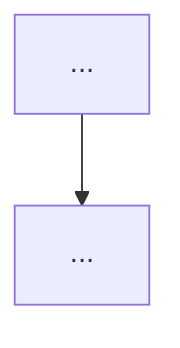

# issue-enhance

Turns a raw issue into a plan a fresh session can implement without this conversation. Requires the repo to have been set up with `issue-workflow-setup`.

## Hard rules

- **Never add `status: approved`.** Only the author sets it — even if asked to "finish" or "complete" the issue. Say so and stop.
- **Keep the author's original text verbatim.** Never rewrite or delete it.
- **One AI section in the body, always overwritten.** Everything you write goes below `---` and the `> 🤖 AI-enhanced (Claude Code), <YYYY-MM-DD>` header. It is the latest complete plan: each revision replaces that whole section; never stack a second one. The implementing session reads only the body.
- **One AI comment per body change.** Every time you change the body (Step 5 first enhancement, each Step 5b revision, Step 6 split, Step 7 rejection) or ask needs-info questions (Step 3), post a `gh issue comment` whose first line is `🤖 AI <YYYY-MM-DD>`, followed by what changed this round and why. Other AI comments (e.g. already-done evidence) use the same first line. The author's comments have no prefix, so any comment not starting with 🤖 is the author's.
- **Why markers:** the AI posts with the author's `gh` login, so GitHub's author field can't tell AI from author; only these fixed markers can.
- **Don't close issues on your own judgement.** Closing happens only when the author has rejected an idea in this session (see Step 7).

## Step 0 — Pick the issues

```bash
# one issue
gh issue view <N> --json number,title,body,labels,comments
# batch: every raw issue, plus needs-info issues where the author replied after the AI's question
# (filter --json locally: `--label` goes through the search index, which lags right after label edits)
gh issue list --state open --limit 500 --json number,title,labels \
  --jq '.[] | select([.labels[].name] | index("status: raw") or index("status: needs-info")) | "#\(.number) [\(.labels | map(.name) | map(select(startswith("status: "))) | join(","))] \(.title)"'
```

In batch mode, list them all first, then enhance one at a time, finishing each (label changed) before starting the next.

Read the repo's `CLAUDE.md` `## Issue workflow` section for the verify command, preview URL, and issue assets branch.

## Prerequisite — gh version

`gh issue create --help | grep -q -- --parent || echo "gh too old: upgrade gh for --parent / --blocked-by"`. If it's too old, ask the author to upgrade `gh` (don't do it for them) and stop.

## Step 1 — Check the code first

For an **article-writing issue**, skip to Step 5a: one with `article: devlog` or `article: intro`, or with `article` in the repo that is its own `Article target`. A plain `article` label in a code repo only means "write an article after this ships"; that issue gets the normal plan.

Search the codebase for what the issue asks for. If it is **already done**, comment (first line `🤖 AI <YYYY-MM-DD>`) with the evidence (file:line, commit) and tell the author it can be closed. Leave the labels and the closing to them. Stop.

## Step 2 — Is it one vertical slice?

One issue = one vertical slice a single fresh session can finish (implement, verify, open PR).

- **Several unrelated ideas in one issue** → one sub-issue per idea (Step 6); the original becomes the parent.
- **One idea, too big for one session** → ordered sub-issues, each later one **blocked by** the one before (native dependency, Step 6). Don't write `Blocked by #N` in the body.

## Step 3 — Blocked on a specific question?

If you cannot write the plan without an answer only the author has:

```bash
gh issue comment <N> --body-file <questions.md>
gh issue edit <N> --remove-label "status: raw" --add-label "status: needs-info"
```

The comment starts with `🤖 AI <YYYY-MM-DD>`. Questions must be specific and answerable: numbered, each with the options you see and your recommendation. "Please provide more information" is not allowed. Stop here for this issue.

## Step 4 — UI work and open choices: options side by side

For any UI change, or any choice that isn't settled yet, show **2–3 versions side by side in the same round** and ask the author to pick one (multiple choice) **before** writing the plan. Never one version per round: the author should see the failures and the compromises together. For UI, attach a 375px-wide screenshot of each version. Only the chosen option goes into the issue.

Store images on the repo's `issue-assets` branch: never merged, never on a public CDN.

```bash
git fetch origin issue-assets 2>/dev/null \
  && git worktree add ../.issue-assets issue-assets \
  || git worktree add --orphan -b issue-assets ../.issue-assets
mkdir -p ../.issue-assets/<N>
cp <mockup>.png ../.issue-assets/<N>/
git -C ../.issue-assets add <N> && git -C ../.issue-assets commit -m "Mockups for #<N>"
git -C ../.issue-assets push -u origin issue-assets
git worktree remove ../.issue-assets
```

Reference them as `https://github.com/<owner>/<repo>/blob/issue-assets/<N>/<file>.png?raw=true` (works for private repos when the viewer is logged in).

## Step 5 — Write the enhanced body

Write the AI section below the original text; on later revisions, replace the existing AI section (from `---` + the 🤖 header to the end) instead of adding another. Write prose in the issue's language; keep the headings as-is so other skills can find them.

````markdown
<original author text, untouched>

---

> 🤖 AI-enhanced (Claude Code), <YYYY-MM-DD>. Waiting for author review.

## Current state
- What exists today, each point with `path/to/file.ext:123`.

## Conditions the description left out
- Conditions this enhancement added that the author's original text didn't state (edge cases, constraints, defaults). The author uses this list to practise writing a more complete first description.

## Decisions
- <YYYY-MM-DD> — <decision> — <why>. (Mark which ones the author made vs. AI defaults.)

## Approach
- Ordered steps a fresh session can follow.

## Flow


## Mockup
<chosen option image; UI issues only>

## Acceptance criteria
- [ ] Observable behaviour, testable by a person or a command. Not file paths.

## Verification
- Commands: `<verify command from CLAUDE.md>`, plus any targeted test.
- Manual: <steps on the preview URL or locally>.
````

**Validate mermaid before posting.** Render it locally and fix errors:

```bash
npx -y @mermaid-js/mermaid-cli -i flow.mmd -o flow.svg
```

Then:

```bash
gh issue edit <N> --body-file <body.md>
gh issue edit <N> --remove-label "status: raw" --remove-label "status: needs-info" --add-label "status: ai-enhanced"
gh issue comment <N> --body "🤖 AI <YYYY-MM-DD>

<what this round added or changed, and why>"
```

## Step 5a — Article issues: an outline, not an implementation plan

An article-writing issue (see Step 1) gets an article outline. Read only the sources listed in its `## Sources` section (see `article-write` Step 2 for how). Never search a source repo for other files. If it has neither `article: devlog` nor `article: intro`, ask which and add it.

Same rules as Step 5 (author text untouched, one AI section, 🤖 comment), with this AI section:

````markdown
---

> 🤖 AI-enhanced (Claude Code), <YYYY-MM-DD>. Waiting for author review.

## Mode
`article: devlog` (reconstruct the decision path) or `article: intro` (introduce it to new readers).

## Main thread
- The one thread the article follows, in a sentence or two.

## Sections
1. <section>: <what it says>. Material: <which source / which part of 文章素材>.

## Not writing
- What is deliberately left out, and why.

## Conditions the description left out
- …

## Acceptance criteria
- [ ] Reader-level outcomes (e.g. "a reader new to X can say what it does after the first section").

## Verification
- Build/preview per the article repo's `## Article conventions`.
````

Then move the label to `status: ai-enhanced` and comment, as in Step 5.

## Step 5b — Author asks for changes

When the author asks for changes after seeing mockups or the enhanced issue:

1. Revise the plan.
2. If it's a choice, show a new set of options side by side (Step 4).
3. Add any new condition the author supplied this time to **Conditions the description left out**.
4. Overwrite the AI section of the body with the full revised plan (`gh issue edit <N> --body-file <body.md>`); the author's text stays untouched.
5. Post a comment starting `🤖 AI <YYYY-MM-DD>`: what changed this round and why.
6. Keep the label at `status: ai-enhanced`.

## Step 6 — Splitting into sub-issues

Create each slice as a native sub-issue of the original, and express order as native dependencies:

```bash
# first slice
gh issue create --parent <original> --title "<slice 1>" --body-file <slice1.md> --label "status: ai-enhanced"
# later slice, blocked by the previous one
gh issue create --parent <original> --blocked-by <slice1> --title "<slice 2>" --body-file <slice2.md> --label "status: ai-enhanced"
# existing issues: attach / add a dependency after the fact
gh issue edit <original> --add-sub-issue <A>,<B>
gh issue edit <B> --add-blocked-by <A>
# undo: --remove-sub-issue <A> / --remove-blocked-by <A>
# check
gh issue view <N> --json parent,subIssuesSummary,blockedBy,blocking
```

Each child body is all AI-written, so it starts with the 🤖 header and follows the Step 5 template. The parent/child link and the dependencies live in GitHub, not in the text: no `Part of #N`, no `Blocked by #N`, no `## Slices` checklist.

The original becomes the parent: keep the author's text, label it `status: ai-enhanced`, and comment `🤖 AI <YYYY-MM-DD>` with the split and the reason. A parent has no acceptance criteria of its own and isn't implemented directly. Its progress is the sub-issue summary.

## Step 7 — Author rejects an idea

When the author rejects an idea in the session, record the reason in one comment and close it:

```bash
gh issue close <N> --reason "not planned" --comment "🤖 AI <YYYY-MM-DD>

Rejected by the author on <YYYY-MM-DD>: <their reason, in their words>."
```

## Done when (per issue)

- [ ] Either: already-done evidence posted; or `status: needs-info` with specific questions; or `status: ai-enhanced` with every section filled (Mockup only for UI; article issues use the Step 5a outline).
- [ ] Splits are native sub-issues; order is native blocked-by; no `Blocked by #N` / `## Slices` text.
- [ ] Original text is intact; exactly one AI section, below `---` and the 🤖 header.
- [ ] Every body change has a matching `🤖 AI <date>` comment saying what changed and why.
- [ ] **Conditions the description left out** lists every condition you added.
- [ ] Open choices were shown as 2–3 versions side by side (UI: 375px screenshots).
- [ ] Mermaid rendered without errors.
- [ ] No `status: approved` added.
